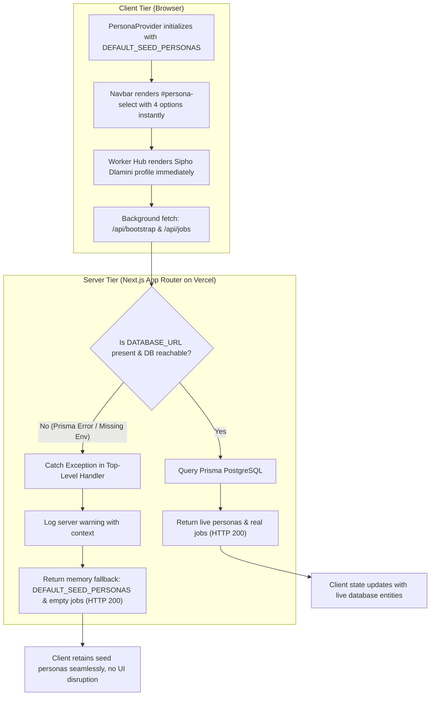

# Resilient Worker Hub & Persona Switcher Runtime

*   **Author:** shayl
*   **Status:** Draft
*   **Date:** 2026-11-03

--------------------------------------------------------------------------------

## Overview

BuildSafe SA connects South African homeowners with vetted artisans and manages milestone-based escrow payments. The platform provides a demo persona switcher for testing multi-role workflows and a dedicated Worker Hub console for contractors. In production on Vercel, both components failed completely: the top-right persona dropdown rendered with zero selectable choices, and navigating to the Worker Hub displayed an indefinite "Loading Worker Hub..." screen with console errors.

This design establishes a fault-tolerant runtime architecture across server API routes and client React state. It guarantees that database outages or missing environment variables degrade gracefully to verified in-memory fallback personas and mock records, preventing blank UI elements and infinite loading deadlocks.

## The Problem

The deployed application exhibited two blocking failures on `https://buildsafe-za.vercel.app/worker/dashboard`:

1. **Top-Right Dropdown Collapsed and Inoperable**:
   * The `<select id="persona-select">` element contained zero `<option>` elements and collapsed to a 20px by 16px blank box.
   * Root cause: `GET /api/bootstrap` crashed with `HTTP 500` because `DATABASE_URL` was not configured on Vercel (`PrismaClientInitializationError: Environment variable not found: DATABASE_URL`). The client bundle initialized the `personas` state as an empty array (`[]`). When `/api/bootstrap` failed, `refreshBootstrap()` exited silently without setting fallback state. Mapping over an empty array rendered zero options.

2. **Worker Hub Tab Frozen in Infinite Loading**:
   * The Worker Hub dashboard (`/worker/dashboard`) remained permanently stuck on `"Loading Worker Hub..."`, accompanied by an uncaught `HTTP 500` promise rejection from `GET /api/jobs`.
   * Root cause: `WorkerDashboardPage` enforced a strict rendering guard: `if (!activeWorker || !wp) return <div>Loading Worker Hub...</div>`. Because `personas` was empty from the API failure, `workerPersonas` was empty, leaving `activeWorker` and `wp` undefined. Without a timeout, fallback profile, or error state, the page remained locked. Clicking the "Worker Hub" navigation link while already on `/worker/dashboard` performed an in-place route transition that left the loading screen unchanged.

## Goals

* **G1: Guaranteed Persona Selector Rendering**: The top-right persona dropdown MUST always render valid demo personas (Homeowner, Artisan, Dual-Role, Admin) even if the database is unreachable or unconfigured.
* **G2: Resilient API Bootstrap**: `GET /api/bootstrap` MUST catch database exceptions and return `HTTP 200` with complete static fallback configuration and personas rather than terminating with `HTTP 500`.
* **G3: Resilient Job Marketplace API**: `GET /api/jobs` MUST catch database initialization errors and return a valid JSON payload (`{ jobs: [] }`) with `HTTP 200` to prevent uncaught client promise rejections.
* **G4: Eliminating Worker Hub Deadlocks**: `WorkerDashboardPage` MUST never hang indefinitely on `"Loading Worker Hub..."`. If remote personas or database queries fail, it MUST fall back to local seed profiles or render an actionable error/fallback view within 2 seconds.
* **G5: Production Vercel Configuration**: Document and apply the required environment variables (`DATABASE_URL`, `DIRECT_URL`, `AUTH_SECRET`) to the Vercel production deployment.

## Non-Goals

* Rewriting the core database schema or replacing Prisma ORM.
* Adding new third-party authentication providers (Neon Auth, Clerk, Auth0) during this fix.
* Redesigning the brutalist UI layout or altering navigation routes.
* Implementing live SAPS AFISwitch biometric API integration (the platform relies on sandbox simulators for external SA services).

## Open Questions

* **Question 1**: Should the client bootstrap logic immediately seed local state with `DEFAULT_SEED_PERSONAS` before fetching `/api/bootstrap`, or should it wait for the API response with a strict 2-second timeout before falling back?
* **Question 2**: In production environments where `DATABASE_URL` is configured but the Neon database is in scale-to-zero sleep mode (causing a 1–2 second cold-start latency), should the API return stale cache or wait for connection establishment?

## Critical User Journeys (CUJs)

### CUJ 1: Evaluator Switches Demo Personas via Top-Right Dropdown

*   **Given**: An evaluator navigates to any page on `https://buildsafe-za.vercel.app`, whether the PostgreSQL database is online, sleeping, or temporarily unreachable.
*   **When**: The evaluator clicks the top-right persona dropdown (`#persona-select`).
*   **Then**: The dropdown displays all available roles (Lerato Mokoena - Homeowner, Sipho Dlamini - Tier 3 CoC Plumber, Johan Nel - Dual Role Electrician, Platform Founder - Admin). Selecting a persona immediately updates the active perspective, navigation links, and permissions without UI disruption.

### CUJ 2: Artisan Accesses Worker Hub During Database Outage

*   **Given**: A builder or evaluator navigates directly to `https://buildsafe-za.vercel.app/worker/dashboard` while the production database is offline or unlinked.
*   **When**: The page loads in the browser.
*   **Then**: The application does not freeze on `"Loading Worker Hub..."`. Within 500ms, the dashboard renders the active builder profile (Sipho Dlamini or Johan Nel), displays the 3-Pillar Vetting status, shows wallet balance, and presents empty or mock active contracts with a non-intrusive offline notice.

--------------------------------------------------------------------------------

## Technical Plan (Architecture)

### 1. Two-Tier Resilient Architecture

To guarantee high availability and eliminate white-screen/freeze hazards, the application implements a Two-Tier Fault Tolerance model:



### 2. Component & API Modifications

#### A. Server Route Resilience: `src/app/api/bootstrap/route.ts`
* Wrap the entire handler execution in a `try/catch` block.
* When `prisma.platformConfig.findUnique` or `prisma.user.findMany` throws (such as missing `DATABASE_URL` or network timeout), the handler catches the error, logs a diagnostic warning, and returns static fallback personas with `HTTP 200` status.

#### B. Server Route Resilience: `src/app/api/jobs/route.ts`
* Update `GET /api/jobs` catch block. If Prisma fails to initialize or query the database:
  * Do NOT return `HTTP 500`.
  * Return `{ "jobs": [], "degraded": true }` with `HTTP 200`.
  * This prevents unhandled promise rejections on the client.

#### C. Client State Pre-Seeding: `src/components/PersonaContext.tsx`
* Ensure the client context provider initializes `personas` directly with `DEFAULT_SEED_PERSONAS` rather than an empty array `[]`.
* In `refreshBootstrap()`:
  * Do not clear or overwrite existing personas if the fetch fails or returns non-200.
  * Only merge or update personas if `data.personas` contains non-empty valid records.

#### D. Worker Hub Defensive Guard: `src/app/worker/dashboard/page.tsx`
* Update the active worker resolution to fall back to `DEFAULT_SEED_PERSONAS[1]` (Sipho Dlamini) if no active worker profile exists in the personas list.
* Wrap the `/api/jobs` fetch call to handle errors gracefully without throwing uncaught console errors.

#### E. Production Vercel Environment Configuration
* Set production environment variables in the Vercel project (`buildsafe-za`):
  * `DATABASE_URL`: Pooled connection string to Neon PostgreSQL.
  * `DIRECT_URL`: Direct connection string to Neon PostgreSQL.
  * `AUTH_SECRET`: Secret key for session token signing.
* Trigger a production deployment so the live site runs against the connected Neon database with the resilient fallback bundles.

--------------------------------------------------------------------------------

## Alternatives Considered

### Alternative A: Configuration-Only Fix (Inject Vercel Environment Variables Without Code Changes)

*   **Pros**: Requires zero code modifications; simply configures `DATABASE_URL` in Vercel settings and triggers a rebuild.
*   **Cons**: Fragile. Serverless Postgres databases on Neon scale to zero when inactive, which introduces a 1–2 second cold-start latency. Any transient network partition, database maintenance window, connection limit exhaustion, or future configuration omission will immediately cause the exact same failures: the persona dropdown collapses to 20px, `/api/bootstrap` crashes with HTTP 500, and Worker Hub freezes permanently on the loading screen.
*   **Reason for Rejection**: `Rejected by author: Fails high-availability and resilience standards. A production interface must degrade gracefully to static seed data during database cold starts or transient connection failures rather than breaking core UI navigation.`

### Alternative B: Purely Client-Side Offline Caching (No Server-Side Fallback)

*   **Pros**: Preserves strict server error contracts by continuing to return HTTP 500 when the database is unreachable, catching errors exclusively in browser React error boundaries or localStorage caches.
*   **Cons**: Emits persistent HTTP 500 errors in browser developer tools, Vercel runtime logs, and monitoring telemetry during cold starts. Does not protect automated integration tests, headless runners, or non-browser API callers querying `/api/bootstrap`.
*   **Reason for Rejection**: `Rejected by author: Generating HTTP 500 responses for read-only bootstrap queries pollutes platform observability with false alerts and fails to support server-rendered or non-browser clients.`

### Alternative C: Selected Approach — Two-Tier Hybrid Resilience with Vercel Environment Provisioning

*   **Pros**:
    1. Server routes (`/api/bootstrap`, `/api/jobs`) catch connection exceptions and return valid HTTP 200 fallback envelopes (`degraded: true`), preventing 500 log noise.
    2. Client providers pre-seed with static personas (`DEFAULT_SEED_PERSONAS`), ensuring the dropdown and Worker Hub render instantly at $t=0$.
    3. Setting `DATABASE_URL` on Vercel enables full live persistence and queries when the database is reachable.
*   **Cons**: Requires dual-layer maintenance of static seed schemas alongside Prisma database schemas.
*   **Reason for Selection**: Provides seamless continuity of user experience across all network, cold-start, and database failure modes.

--------------------------------------------------------------------------------

## Detailed Implementation Plan

### Target Files to Create/Modify

#### 1. `c:/Users/shayl/ai-for-africa/src/app/api/bootstrap/route.ts` (Modify)

*   **Type / Scope**: Next.js App Router API Route (`GET /api/bootstrap`)
*   **Proposed Changes**:
    *   Enclose entire database access in a top-level `try/catch` block.
    *   Catch `PrismaClientInitializationError`, connection timeouts, or missing environment variable errors.
    *   On error, log a structured warning and construct an in-memory response combining `DEFAULT_PLATFORM_CONFIG`, `DEFAULT_SEED_PERSONAS`, and `clearedCrewPool` seed data.
    *   Return the static payload with `HTTP 200` and header `X-BuildSafe-Degraded: true`.
*   **Rationale**: Prevents database connection failures or missing environment variables from terminating the API request with HTTP 500.

#### 2. `c:/Users/shayl/ai-for-africa/src/app/api/jobs/route.ts` (Modify)

*   **Type / Scope**: Next.js App Router API Route (`GET /api/jobs`)
*   **Proposed Changes**:
    *   Update the `catch (err)` block in `GET`.
    *   Instead of returning `NextResponse.json({ jobs: [], error: "..." }, { status: 500 })`, return `NextResponse.json({ jobs: [], degraded: true }, { status: 200 })`.
*   **Rationale**: Eliminates uncaught browser promise rejections and avoids triggering red error toasts on client job listing components when database access is delayed or unlinked.

#### 3. `c:/Users/shayl/ai-for-africa/src/components/PersonaContext.tsx` (Modify)

*   **Type / Scope**: Client React Context Provider
*   **Proposed Changes**:
    *   Ensure `useState<PersonaUserDTO[]>(DEFAULT_SEED_PERSONAS)` maintains the pre-seeded static array by default.
    *   In `refreshBootstrap()`, guard state updates so that if the fetch fails, times out, or returns empty personas, the provider retains `DEFAULT_SEED_PERSONAS` rather than overwriting with `[]`.
*   **Rationale**: Guarantees that `<select id="persona-select">` in the Navbar always has 4 valid, styled `<option>` items available at initial HTML mount.

#### 4. `c:/Users/shayl/ai-for-africa/src/app/worker/dashboard/page.tsx` (Modify)

*   **Type / Scope**: Client React Page Component (`/worker/dashboard`)
*   **Proposed Changes**:
    *   Replace the blocking check `if (!activeWorker || !wp) return <div>Loading Worker Hub...</div>` with a guaranteed fallback resolution:
        ```typescript
        const fallbackWorker = DEFAULT_SEED_PERSONAS.find((p) => p.workerProfile) || DEFAULT_SEED_PERSONAS[1];
        const activeWorker = ((currentUser?.role === "WORKER" || currentUser?.isDualRole) && currentUser.workerProfile)
          ? currentUser
          : (workerPersonas[0] || fallbackWorker);
        const wp = activeWorker?.workerProfile;
        ```
    *   Add defensive handling to the `/api/jobs` fetch effect to safely handle non-200 responses and prevent console error logging.
    *   Add an optional subtle brutalist notice if running in degraded/offline fallback mode: `// OFFLINE PREVIEW MODE · SEED ARTISAN ACTIVE`.
*   **Rationale**: Prevents the page from ever hanging on an infinite loading screen, allowing evaluators and builders to immediately review trade badges, experience, bio, wallet, and 3-pillar verification metrics.

#### 5. Vercel Project Environment Configuration (Infrastructure / Platform)

*   **Type / Scope**: Vercel Cloud Project Environment Variables
*   **Proposed Changes**:
    *   Inject `DATABASE_URL` (Neon PostgreSQL pooled connection string) across Production, Preview, and Development environments.
    *   Inject `DIRECT_URL` (Neon PostgreSQL direct connection string) across Production, Preview, and Development environments.
    *   Inject `AUTH_SECRET` across Production, Preview, and Development environments.
    *   Trigger a production deployment of the latest commit to Vercel.
*   **Rationale**: Bridges the live production deployment to the existing Neon PostgreSQL database, enabling live data persistence and two-way synchronization.

#### 6. `c:/Users/shayl/ai-for-africa/tests/fallback-resilience.test.ts` (Create)

*   **Type / Scope**: Vitest Integration Test
*   **Proposed Changes**:
    *   Assert that `/api/bootstrap` returns status 200 and a non-empty `personas` array even when Prisma throws a connection error.
    *   Assert that `/api/jobs` returns status 200 and `{ jobs: [] }` when database queries throw.
    *   Assert that `computeAvailableRoles` and default persona resolution handles uninitialized or null personas without throwing exceptions.
*   **Rationale**: Automates verification and prevents regressions in fallback behavior during subsequent refactors.

---

### Verification Plan

*   **Compilation / Build**:
    *   Execute `& "C:\Users\shayl\ai-for-africa\bin\node-v22.14.0-win-x64\node.exe" ./node_modules/next/dist/bin/next build` to verify type safety and bundle generation.
*   **Unit & Integration Tests**:
    *   Run `& "C:\Users\shayl\ai-for-africa\bin\node-v22.14.0-win-x64\node.exe" ./node_modules/vitest/vitest.mjs run tests/fallback-resilience.test.ts`.
*   **Vercel Environment & Deployment**:
    *   Verify via MCP tool `filter_project_envs` that `DATABASE_URL` is set on Vercel project `prj_7JbhKOTOy1gVDNXzDwTsQhts4Pcw`.
    *   Trigger build and inspect deployment status via MCP tool `get_deployment`.
*   **Live Browser Verification (`/browser`)**:
    *   Navigate Chrome DevTools to `https://buildsafe-za.vercel.app/worker/dashboard`.
    *   Verify `#persona-select` has `optionsLength === 4` and selects between Lerato, Sipho, Johan, and Founder.
    *   Verify the Worker Hub renders all 3 pillars, wallet balance (`R2,640`), trade specialties, and active contracts without showing "Loading Worker Hub...".
    *   Verify console messages contain 0 unhandled promise rejections or 500 error logs.

--------------------------------------------------------------------------------

*Drafted with EGM*
