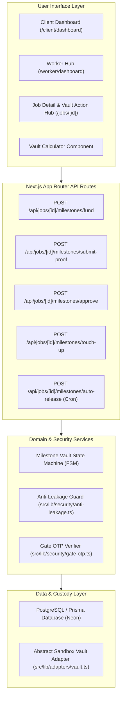
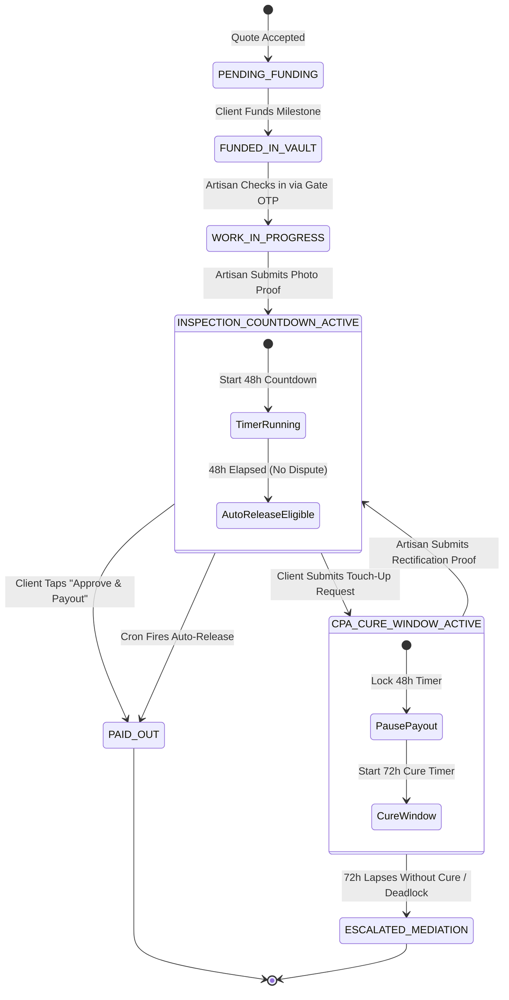

# Milestone Vault & Job Guarantee Architecture

*   **Author:** shayl
*   **Status:** Draft
*   **Date:** 2026-11-03

--------------------------------------------------------------------------------

## Overview

BuildSafe SA connects South African homeowners with vetted skilled artisans (plumbers, electricians, builders, carpenters). The current platform uses legalistic "escrow" phrasing across its user interface, causing confusion and apprehension among both homeowners and artisans in South Africa. Furthermore, holding models that allow unilateral client refund claims expose artisans to contractor wage theft, while models charging fees on hardware materials incentivize off-platform cash transactions.

This design document establishes the **Milestone Vault & Job Guarantee** system. It replaces alienating legal jargon with accessible terminology, separates 0%-fee hardware store pass-through receipts from labour milestones, establishes an automated 48-hour inspection countdown to prevent client ghosting, and introduces a customer-facing **72-Hour Fix Window** ("Request a Touch-Up") that gives artisans a direct opportunity to inspect and fix flagged issues before any payment freeze can occur (fulfilling the legal protections of CPA Section 54 without burdening users with legal jargon).

## The Problem

1. **Jargon Alienation ("Escrow")**:
   * The term "escrow" appears across UI headers, buttons (`Release Milestone Escrow`), fee calculators, and status badges (`ESCROW_FUNDED`).
   * In South Africa, "escrow" is perceived as conveyancing and corporate legal jargon. For artisans, it raises fears that their money is trapped in a corporate bank that will side with the homeowner. For homeowners, it sounds like an administrative barrier rather than a safety guarantee.

2. **Asymmetric Counterparty Risk & Wage Theft**:
   * Labor cannot be repossessed once performed. If a platform gives homeowners unilateral power to cancel a milestone or demand a full refund after completion, artisans carry all counterparty risk.
   * Under South African common law (*BK Tooling v Scope Precision Engineering* 1979) and statutory law (CPA Section 54), a client cannot withhold 100% of payment for minor defects if substantial performance was rendered, and must allow the contractor a reasonable opportunity to remedy defects.

3. **Material Fee Disintermediation**:
   * Charging platform commission on pass-through materials (e.g. tile boxes, copper piping, cement bags) penalizes artisans who operate on narrow margins. This actively forces both parties to settle materials off-platform in cash, leading to complete transaction leakage.

4. **Homeowner Ghosting After Completion**:
   * When an artisan finishes a job, homeowners often delay formal sign-off due to busy schedules, forgetting, or bad faith. Without an automated release mechanism, artisan funds remain locked indefinitely.

## Goals

* **G1: Terminology Normalization**: Remove all user-facing instances of "escrow" across navigation, dashboards, calculators, job views, and status badges, replacing them with "Milestone Vault" and "Job Guarantee".
* **G2: Strict Segregation of Materials and Labour**: Enforce a 0% platform fee on itemized hardware store receipts (Builders Warehouse, Cashbuild), keeping material reimbursement at exact pass-through cost.
* **G3: Automated 48-Hour Inspection Timer**: Trigger an automated 48-hour countdown clock when an artisan submits timestamped photo proof of completion. If the client takes no action, funds auto-release to the artisan.
* **G4: 72-Hour Fix Window ('Request a Touch-Up')**: Replace adversarial dispute/refund buttons with a simple "Request a Touch-Up" action. Clients flagging issues upload a photo and note, giving the artisan a clear 72-hour window to return and fix the problem before any payment is frozen or escalated.
* **G5: Abstract Sandbox Vault Adapter**: Provide an in-memory/database sandbox adapter simulating vault deposit, inspection countdowns, touch-up requests, and auto-releases without external banking dependencies during initial testing.

## Non-Goals

* Holding client deposit funds directly in BuildSafe SA's operational company checking accounts (custodial holding in production must route through a licensed third-party trust/escrow partner).
* Operating an internal consumer credit or material financing facility.
* Offering platform insurance or guarantees for manufacturer material defects (e.g., cracked tiles from the supplier).
* Automating formal legal arbitration for claims exceeding the held milestone value (unresolved claims escalate to human mediation).

## Open Questions

* **Question 1**: How should the system handle national load shedding or major cellular network blackouts that prevent a homeowner from accessing the app during the 48-hour inspection countdown?
* **Question 2**: In multi-stage projects with multiple milestones, can an artisan proceed to Milestone 2 before Milestone 1 is released, or must each milestone be funded and settled sequentially?

## Critical User Journeys (CUJs)

### CUJ 1: Homeowner Funds Milestone Vault & Unlocks Gate Check-In

*   **Given**: A homeowner accepts a plumber's quote (R3,000 labour + R800 estimated materials).
*   **When**: The homeowner clicks "Secure Funds in Milestone Vault" and completes payment of the R250 commitment deposit and R3,000 labour milestone.
*   **Then**: The vault status updates to "Funds Secured in Vault", the masked contact details unlock, and a 6-digit Gate OTP is generated for the artisan's physical arrival.

### CUJ 2: Artisan Submits Photo Proof & 48-Hour Timer Auto-Releases

*   **Given**: An artisan completes bathroom tiling and checks out via Gate OTP.
*   **When**: The artisan uploads two photos (wide shot of finished floor and close-up of grouting) and taps "Submit Work for Payout".
*   **Then**: The milestone transitions to `INSPECTION_COUNTDOWN_ACTIVE`. The homeowner receives an SMS and WhatsApp notification indicating that funds will auto-release in 48 hours unless a touch-up is requested. If the homeowner does not respond, funds release automatically to the artisan at $T+48$ hours.

### CUJ 3: Homeowner Requests a Touch-Up

*   **Given**: A milestone is in the 48-hour inspection window, and the homeowner identifies an unsealed pipe joint.
*   **When**: The homeowner clicks "Request a Touch-Up", attaches a photo of the leaking joint, and submits a brief description.
*   **Then**: The 48-hour auto-release timer pauses immediately. The milestone enters `TOUCH_UP_WINDOW_ACTIVE`, and the artisan receives a message: "Touch-up requested. You have 72 hours to inspect and fix the flagged issue on site before payment review."

--------------------------------------------------------------------------------

## Technical Plan (Architecture)

### 1. Architectural Topology & Component Boundaries

The Milestone Vault architecture decouples funds orchestration, state management, and user interfaces into four distinct layers:



### 2. Milestone Finite State Machine (FSM)

Each job milestone operates as an isolated state machine with strict state transitions, enforcing legal and temporal invariants:



### 3. API Route Specifications

#### A. `POST /api/jobs/[id]/milestones/fund`
* **Caller**: Authenticated Homeowner.
* **Payload**: `{ "milestoneId": "string", "paymentMethod": "SANDBOX_EFT" | "CARD" }`.
* **Behavior**:
  * Calls `vaultAdapter.allocateFunds({ milestoneId, amount })`.
  * Transitions milestone to `FUNDED_IN_VAULT`.
  * Generates Gate OTP for artisan check-in if not already active.
* **Response**: `HTTP 200 { "status": "FUNDED_IN_VAULT", "gateOtp": "482915" }`.

#### B. `POST /api/jobs/[id]/milestones/submit-proof`
* **Caller**: Authenticated Artisan.
* **Payload**: `{ "milestoneId": "string", "photoUrls": string[], "notes": "string" }`.
* **Preconditions**: Milestone status must be `WORK_IN_PROGRESS`; `photoUrls.length >= 1`.
* **Behavior**:
  * Saves photo records in `milestone_proofs`.
  * Sets `proof_submitted_at = NOW()`.
  * Sets `auto_release_deadline = NOW() + INTERVAL '48 HOURS'`.
  * Transitions milestone status to `INSPECTION_COUNTDOWN_ACTIVE`.
* **Response**: `HTTP 200 { "status": "INSPECTION_COUNTDOWN_ACTIVE", "deadline": "ISO_TIMESTAMP" }`.

#### C. `POST /api/jobs/[id]/milestones/approve`
* **Caller**: Authenticated Homeowner.
* **Payload**: `{ "milestoneId": "string" }`.
* **Behavior**:
  * Uses database row-level locking (`SELECT ... FOR UPDATE`) to prevent concurrent cron execution.
  * Verifies milestone is in `INSPECTION_COUNTDOWN_ACTIVE` or `WORK_IN_PROGRESS`.
  * Dispatches payout through `vaultAdapter.disbursePayout()`.
  * Updates milestone status to `PAID_OUT`.
* **Response**: `HTTP 200 { "status": "PAID_OUT", "payoutZar": 2760.00 }`.

#### D. `POST /api/jobs/[id]/milestones/touch-up` (CPA Section 54)
* **Caller**: Authenticated Homeowner.
* **Payload**: `{ "milestoneId": "string", "defectDescription": "string", "evidencePhotos": string[] }`.
* **Preconditions**: Must be in `INSPECTION_COUNTDOWN_ACTIVE`; `defectDescription.length >= 20`; `evidencePhotos.length >= 1`.
* **Behavior**:
  * Pauses the 48-hour auto-release deadline (`auto_release_deadline = NULL`).
  * Creates record in `cpa_cure_events` with `cure_deadline = NOW() + INTERVAL '72 HOURS'`.
  * Sets milestone status to `CPA_CURE_WINDOW_ACTIVE`.
  * Sends priority alert to artisan via notification service.
* **Response**: `HTTP 200 { "status": "CPA_CURE_WINDOW_ACTIVE", "cureDeadline": "ISO_TIMESTAMP" }`.

#### E. `POST /api/jobs/[id]/milestones/auto-release`
* **Caller**: Internal cron worker or scheduled task runner with secret bearer token.
* **Behavior**:
  * Queries milestones where `status = 'INSPECTION_COUNTDOWN_ACTIVE'` AND `auto_release_deadline <= NOW()`.
  * Acquires row-level lock.
  * Dispatches payout via `vaultAdapter.disbursePayout()` with idempotency key `autorelease_{milestoneId}`.
  * Transitions status to `PAID_OUT` with audit log `triggered_by: SYSTEM_AUTO_RELEASE`.

### 4. Concurrency & Race Condition Safeguards

To prevent race conditions where a client clicks "Approve" at hour 47:59 while the background cron fires at the same second:
1. **Pessimistic Row-Level Locking**: All release operations execute inside an atomic database transaction using `SELECT * FROM job_milestones WHERE id = $1 FOR UPDATE`.
2. **Idempotency Keys**: Payout dispatch requests pass a deterministic idempotency key `payout_{milestone_id}` to `vaultAdapter`. If a duplicate payout is submitted, the adapter returns the original cached settlement result without transferring funds twice.

### 5. Abstract Sandbox Vault Adapter Interface

Defined in `src/lib/adapters/vault.ts`:

```typescript
export interface VaultAllocationInput {
  milestoneId: string;
  jobId: string;
  labourZar: number;
  materialsZar: number;
  isRepeatBooking?: boolean;
}

export interface VaultDisbursementResult {
  milestoneId: string;
  artisanNetZar: number;
  platformFeeZar: number;
  reimbursedMaterialsZar: number;
  disbursedAt: string;
  transactionRef: string;
}

export interface AbstractVaultAdapter {
  allocateFunds(input: VaultAllocationInput): Promise<{ success: boolean; vaultRef: string }>;
  pauseForCpaCure(milestoneId: string): Promise<{ paused: boolean }>;
  disbursePayout(milestoneId: string, idempotencyKey: string): Promise<VaultDisbursementResult>;
  getVaultBalance(milestoneId: string): Promise<{ labourHeldZar: number; status: string }>;
}
```

### 6. User-Facing Lexicon Migration Map

| Current Jargon / Legalistic Term | Plain-English Application Term | User View & Context |
| :--- | :--- | :--- |
| `"Milestone Escrow"` | `"Milestone Vault"` | Navigation & project overview |
| `"ESCROW_FUNDED"` (UI Badge) | `"FUNDS SECURED IN VAULT"` | Status badge on job cards |
| `"Release Milestone Escrow"` | `"Approve & Payout Labour"` | Primary sign-off button |
| `"Pre-Escrow Anti-Leakage"` | `"Pre-Booking Protection"` | Chat header & info note |
| `"Escrow Fee Calculator"` | `"Milestone & Fee Calculator"` | Interactive pricing calculator |
| `"Dispute / Legal Chargeback"` | `"Request a Touch-Up"` | Action button when issues found |
| `"Statutory Right to Cure (CPA)"` | `"72-Hour Fix Window"` | Notification banner for artisans & clients |
| `"Arbitration / Mediation"` | `"Fair Resolution Support"` | Escalation view if touch-up fails |

--------------------------------------------------------------------------------

## Alternatives Considered

### Alternative A: Pure Lead-Generation & Directory Model (inDrive-Style / Off-Platform Cash)

*   **Pros**:
    *   Zero financial compliance overhead (no SARB, FICA, or trust account regulations).
    *   Dramatically simpler codebase: deletes payment webhooks, payout ledgers, escrow calculators, and dispute state machines.
    *   Artisans can accept cash or private bank transfers directly on site.
*   **Cons**:
    *   **Near-100% Disintermediation**: Once contact details or job addresses are shared, parties immediately take the transaction offline to bypass fees.
    *   **Artisan Churn from Lead Fees**: Skilled contractors reject upfront pay-per-lead models (e.g. Bark, Kandua) where they pay for quotes that rarely convert.
    *   **Zero Brand Defense**: Offers no protection against disappearing contractors or non-paying homeowners, reducing BuildSafe to an undifferentiated classifieds board.
*   **Reason for Rejection**: `Rejected by author: Guarantees near-total off-platform disintermediation, alienates artisans with upfront quoting fees, and destroys BuildSafe's primary value proposition of trust and fraud protection.`

### Alternative B: 100% Full Upfront Project Budget Lock

*   **Pros**:
    *   Complete financial commitment from the client before any tradesperson arrives on site.
    *   Guarantees that the entire project budget (e.g., R45,000 for a kitchen renovation) is fully backed by funds.
*   **Cons**:
    *   Severe consumer friction: Freezing tens of thousands of Rands upfront creates unacceptable drop-off in quote acceptance.
    *   Starves contractors of staged liquidity needed for ongoing transport, consumables, and day-to-day operations.
*   **Reason for Rejection**: `Rejected by author: Creates severe conversion friction for homeowners and denies contractors necessary phased cash flow during multi-week trade jobs.`

### Alternative C: Unilateral Client Refund Button (E-Commerce Return Model)

*   **Pros**:
    *   Provides maximum peace of mind to homeowners unfamiliar with hiring trades online.
    *   Familiar e-commerce mental model ("dissatisfied? get your money back in 1 tap").
*   **Cons**:
    *   Physical construction labor cannot be repossessed or returned once rendered.
    *   Enables client wage theft and weaponized holdouts against honest artisans.
    *   Directly violates South African contract law (*BK Tooling*) and Consumer Protection Act Section 54, which guarantees contractors the statutory right to remedy defects before price reductions or refunds can be enforced.
*   **Reason for Rejection**: `Rejected by author: Unfairly forces artisans to carry 100% of counterparty risk, violates South African consumer law, and destroys artisan retention.`

### Alternative D: Operating an Unlicensed Internal Ledger / Float Account

*   **Pros**:
    *   Allows BuildSafe to capture interest on fund float and avoid third-party payment gateway transaction splits.
    *   Custom in-house control over payout timing and ledger balances.
*   **Cons**:
    *   Directly violates the South African Banks Act and Reserve Bank regulations against unlicensed deposit-taking.
    *   Massive security, insurance, and audit liability.
*   **Reason for Rejection**: `Rejected by author: Extreme regulatory and legal liability. BuildSafe must operate purely as a software orchestrator, relying on sandbox adapters during testing and licensed trust partners (e.g., TradeSafe/Nedbank) in production.`

--------------------------------------------------------------------------------

## Detailed Implementation Plan

### Target Files to Create/Modify

#### 1. `c:/Users/shayl/ai-for-africa/src/lib/adapters/vault.ts` (Create)

*   **Type / Scope**: Domain Adapter & Sandbox Vault Engine (TypeScript Module)
*   **Proposed Changes**:
    *   Define `AbstractVaultAdapter` interface specifying `allocateFunds`, `pauseForTouchUp`, `disbursePayout`, and `getVaultStatus`.
    *   Implement an in-memory/simulated `SandboxVaultAdapter` that records milestone allocations, tracks 48-hour inspection windows, handles 72-hour touch-up freezes, and verifies idempotency keys.
    *   Export a singleton `vaultAdapter` instance for use across App Router API handlers.
*   **Rationale**: Decouples the platform's core milestone lifecycle from external third-party banking APIs, allowing local testing, automated vitests, and UI verification without live payment credentials.

#### 2. `c:/Users/shayl/ai-for-africa/src/lib/adapters/escrow.ts` (Modify)

*   **Type / Scope**: Financial Calculation Module (TypeScript Module)
*   **Proposed Changes**:
    *   Introduce `computeMilestoneSplit` as the canonical calculation function, preserving `computeEscrowSplit` as an alias for backward compatibility.
    *   Update interface names to `MilestoneCalculationInput` and `MilestoneSplitBreakdown` with alias exports.
    *   Add comments clarifying the business invariant: 0% fee on hardware-store materials and separate labour milestone commission splits.
*   **Rationale**: Modernizes the domain calculation terminology while ensuring existing test suites and component imports continue compiling without breaking changes.

#### 3. `c:/Users/shayl/ai-for-africa/src/lib/security/anti-leakage.ts` (Modify)

*   **Type / Scope**: Security & Masked Chat Sanitizer (TypeScript Module)
*   **Proposed Changes**:
    *   Add `isVaultFunded?: boolean` to the sanitization context parameters, accepting both `isVaultFunded` and `isEscrowFunded` interchangeably.
    *   Update error messages and UI notice tags from `"Pre-Escrow Phone Redaction"` to `"Pre-Booking Phone Protection"`.
*   **Rationale**: Eliminates "escrow" phrasing from chat warning banners and security logs while maintaining contact masking until deposit commitment is secured.

#### 4. `c:/Users/shayl/ai-for-africa/src/components/EscrowCalculator.tsx` (Modify)

*   **Type / Scope**: Client React Component (`src/components/EscrowCalculator.tsx`)
*   **Proposed Changes**:
    *   Update header label from `"// 03 · ESCROW FEE CALCULATOR"` to `"// 03 · MILESTONE VAULT CALCULATOR"`.
    *   Replace explanatory subtext with clear plain English: "See how your payment is safely held in the Milestone Vault and paid out upon completion."
    *   Update visual breakdown legend: "Artisan Net Payout", "Materials (0% Fee Pass-Through)", and "BuildSafe Trust & Platform Fee".
*   **Rationale**: Replaces alienating financial jargon with transparent, trust-building explanations on the primary landing page and dashboard drawers.

#### 5. `c:/Users/shayl/ai-for-africa/src/components/Navbar.tsx` (Modify)

*   **Type / Scope**: Primary Navigation Shell (`src/components/Navbar.tsx`)
*   **Proposed Changes**:
    *   Update the breadcrumb resolver mapping to replace `"Escrow"` with `"Milestone Vault"`.
    *   Ensure any tooltips or status pills use "Vault Protected" rather than "Escrow Active".
*   **Rationale**: Removes legacy escrow terminology from top-level layout breadcrumbs and navigation badges.

#### 6. `c:/Users/shayl/ai-for-africa/src/app/page.tsx` (Modify)

*   **Type / Scope**: Public Landing Page (`src/app/page.tsx`)
*   **Proposed Changes**:
    *   Update Hero and feature showcase cards:
        *   Replace `"Release Milestone Escrow"` with `"Approve & Payout Labour"`.
        *   Replace `"Compare Quotes & Test Pre-Escrow Phone Redaction"` with `"Compare Quotes & Test Pre-Booking Phone Protection"`.
        *   Update collapsible drawer header to `"// 03 · MILESTONE VAULT CALCULATOR"`.
*   **Rationale**: Ensures first-time homeowners and visiting tradespeople immediately understand the payment guarantee without stumbling on legal jargon.

#### 7. `c:/Users/shayl/ai-for-africa/src/app/client/dashboard/page.tsx` (Modify)

*   **Type / Scope**: Homeowner Dashboard Page (`src/app/client/dashboard/page.tsx`)
*   **Proposed Changes**:
    *   Update loading state text from `"Fetching client jobs & active escrows..."` to `"Fetching client jobs & active milestones..."`.
    *   Update status badge resolver: map `ESCROW_FUNDED` badge to display `"FUNDS SECURED IN VAULT"`.
    *   Update action buttons on job cards from `"Manage Escrow"` to `"View Milestone Vault"`.
*   **Rationale**: Establishes a reassuring, professional banking-style perspective for clients tracking their home renovation budgets.

#### 8. `c:/Users/shayl/ai-for-africa/src/app/worker/dashboard/page.tsx` (Modify)

*   **Type / Scope**: Artisan Worker Hub Dashboard (`src/app/worker/dashboard/page.tsx`)
*   **Proposed Changes**:
    *   Update contract status labels to display `"Funds Locked in Vault"` instead of `"Escrow Funded"`.
    *   Update wallet breakdown subtext: "Labour earnings held in vault pending 48-hour inspection or touch-up sign-off".
*   **Rationale**: Reassures tradespeople that client funds are legally committed and guaranteed before they travel to the site or start work.

#### 9. `c:/Users/shayl/ai-for-africa/src/app/jobs/[id]/page.tsx` (Modify)

*   **Type / Scope**: Job Action & Milestone Hub Page (`src/app/jobs/[id]/page.tsx`)
*   **Proposed Changes**:
    *   Add a prominent "Milestone Vault Status" card showing:
        *   Allocation breakdown: Labour (Vault Protected) vs. Materials (Direct Pass-Through, 0% Fee).
        *   48-hour inspection countdown timer with progress bar when status is `INSPECTION_COUNTDOWN_ACTIVE`.
        *   "Request a Touch-Up" action button (opening modal with photo upload and issue description).
        *   "Approve & Payout Labour" primary action button.
    *   Add the "72-Hour Fix Window" alert banner when a touch-up has been requested, displaying remaining hours for the artisan to rectify.
*   **Rationale**: Centralizes the complete dispute-prevention and inspection lifecycle in the core job detail view.

#### 10. `c:/Users/shayl/ai-for-africa/src/app/api/jobs/[id]/milestones/route.ts` (Create)

*   **Type / Scope**: Next.js App Router API Handler (`src/app/api/jobs/[id]/milestones/route.ts`)
*   **Proposed Changes**:
    *   Implement `POST` handler supporting actions:
        *   `action: "FUND_MILESTONE"`: Allocates funds into the sandbox vault and unlocks Gate OTP.
        *   `action: "SUBMIT_PROOF"`: Validates photo URLs, sets timestamp, starts 48-hour countdown.
        *   `action: "APPROVE_PAYOUT"`: Releases net payout to artisan and records completion.
        *   `action: "REQUEST_TOUCH_UP"`: Pauses auto-release and starts 72-hour fix window.
*   **Rationale**: Provides a unified, type-safe API endpoint for all milestone state transitions.

#### 11. `c:/Users/shayl/ai-for-africa/tests/milestone-vault.test.ts` (Create)

*   **Type / Scope**: Vitest Integration Test Suite (`tests/milestone-vault.test.ts`)
*   **Proposed Changes**:
    *   Test 1: Assert 0% platform fee on materials and exact pass-through reimbursement in `computeMilestoneSplit`.
    *   Test 2: Assert state transition from `WORK_IN_PROGRESS` to `INSPECTION_COUNTDOWN_ACTIVE` upon photo proof submission.
    *   Test 3: Assert that "Request a Touch-Up" pauses the 48-hour countdown and activates the 72-hour fix window.
    *   Test 4: Assert that auto-release fires successfully when 48 hours lapse with no touch-up request.
    *   Test 5: Assert anti-leakage unlocks contact details only after vault funding is confirmed.
*   **Rationale**: Guarantees automated regression testing for all legal and architectural invariants.

---

### Verification Plan

*   **Compilation & Type Safety**:
    *   Execute `& "C:\Users\shayl\ai-for-africa\bin\node-v22.14.0-win-x64\node.exe" ./node_modules/next/dist/bin/next build` to verify zero type mismatches or broken route handlers.
*   **Unit & Integration Tests**:
    *   Execute `& "C:\Users\shayl\ai-for-africa\bin\node-v22.14.0-win-x64\node.exe" ./node_modules/vitest/vitest.mjs run tests/milestone-vault.test.ts tests/anti-leakage.test.ts`.
    *   Ensure 100% pass rate across milestone calculations, FSM transitions, and anti-leakage phone masking.
*   **Codebase Scan for Jargon Residue**:
    *   Run PowerShell regex search across all `src/app/` and `src/components/` files to verify that zero user-facing strings contain `"escrow"`, `"statutory right to cure"`, or `"BK Tooling"`.
*   **Browser & UI Verification**:
    *   Inspect `http://localhost:3000` via Chrome DevTools MCP.
    *   Verify the landing page drawer displays `"// 03 · MILESTONE VAULT CALCULATOR"`.
    *   Verify the client dashboard displays `"FUNDS SECURED IN VAULT"`.
    *   Verify job action hub renders the 48-hour inspection countdown and "Request a Touch-Up" button.

--------------------------------------------------------------------------------

*Drafted with EGM*


