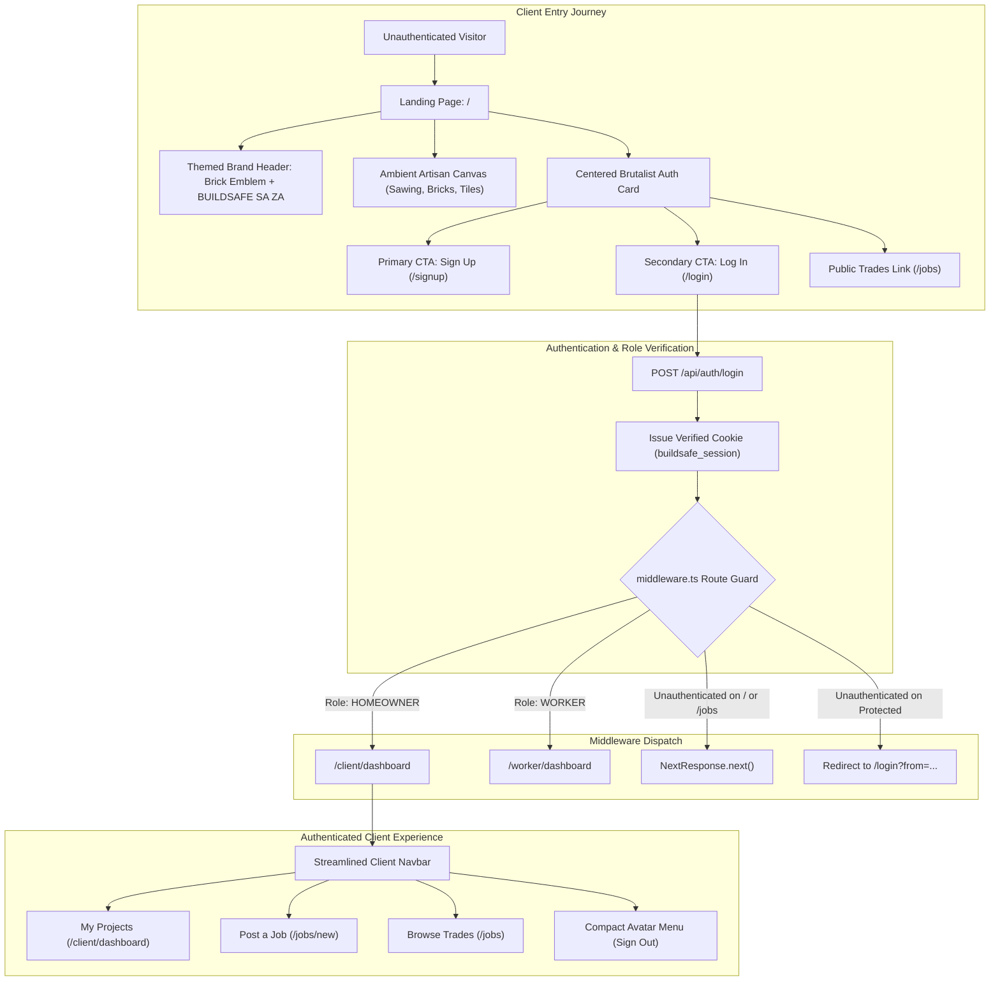

# Client-First Landing Portal & Animated Artisan Canvas

* **Author:** shayl
* **Status:** Approved / Implemented
* **Date:** 2026-11-03

---

## Overview

BuildSafe SA connects South African homeowners with vetted artisans and manages milestone-based escrow payments. The application currently exposes multiple user roles simultaneously through an overloaded top navigation bar with uniform high-contrast borders, resulting in identical visual weight across links, duplicate calls-to-action, and routing conflicts (such as client navigation links routing into worker dashboards or redirect loops).

This design refines the application to focus strictly on one persona at a time, beginning with the **Client (Homeowner)**. It establishes an unauthenticated landing portal on route `/` featuring the platform's brand header lockup (brick masonry emblem, uppercase monospace logotype, and `ZA` national tag), vertically stacked Sign Up and Log In actions in the primary view, trade discovery anchors, and an ambient vector SVG background layer of craftspeople (men and women) performing carpentry, masonry, and tiling tasks to populate ambient whitespace without obstructing conversion actions.

---

## The Problem

1. **Top Bar Overcrowding & Homogeneous Link Affordances**:
   * Every top bar element (Logo, Role View badge, Client Hub, Post a Job, Browse Trades, About Us, Persona Switcher combobox, Star Rating, Wallet balance, and Sign Out) is encased in a 2px black border, imparting identical visual weight to primary actions, secondary links, and status badges.
   * Actions and metrics are duplicated between the top bar and page content (e.g., duplicate "Post a Job" buttons and redundant persona switchers).
   * On tablet (768px) and laptop (1024px) viewports, the bar causes horizontal page overflow or forces text to wrap into unexpected multi-line fragments.

2. **Persona Multiplicity & State Desynchronization**:
   * Exposing Client, Builder, and Admin controls simultaneously causes state confusion.
   * In `src/components/PersonaContext.tsx`, `selectedId` defaults to `"user_homeowner_lerato"`, causing client-side components to treat unauthenticated visitors as logged-in clients.
   * In unauthenticated or misconfigured states, clicking Client Hub routes to `/worker/dashboard` or loops on `/login?from=/client/dashboard`.

3. **Absence of a Dedicated Client Entry Landing Page**:
   * Unauthenticated visitors landing on `/` were historically redirected directly to `/login` by an explicit check in `src/middleware.ts#L52`.
   * Prospective clients require a dedicated entry portal on `/`: clear brand identity, primary Sign Up and Log In actions, and public trade discovery anchors (PIRB Plumbing, ECB Electrical, NHBRC Building) prior to account creation.

---

## Goals

* **G1: Minimalist Client-First Navigation**: Refactor the top navigation bar to remove 2px border boxes around standard text links, suppress persona selectors and wallet badges on unauthenticated views, and isolate navigation controls to the active Client persona.
* **G2: Themed Landing Portal on `/`**: Transform route `/` into a focused entry portal featuring the BuildSafe SA brutalist brand header (brick masonry emblem, uppercase monospace logotype, high-contrast `ZA` black badge, and industrial monospace eyebrow) alongside centered vertical Sign Up and Log In buttons and public trade anchors.
* **G3: Ambient Collaborative Builder Animations**: Populate ambient whitespace with a vector SVG animation layer depicting male and female craftspeople with yellow skin tone performing masonry, carpentry, and tiling tasks:
  * Sawing timber (carpentry)
  * Laying bricks (masonry)
  * Cutting tiles (finishing)
* **G4: Deterministic Client Routing**: Ensure client navigation actions reliably reach `/client/dashboard` without triggering worker redirects or unauthenticated loops.

---

## Non-Goals

* **NG1: Database & ORM Restructuring**: No modifications to PostgreSQL database schemas or Prisma models.
* **NG2: Worker & Admin Portals Overhaul**: Deferring redesign of the artisan Worker Hub and Admin Console to subsequent persona-focused iterations.
* **NG3: Heavy 3D Graphics Engines**: Avoiding external 3D WebGL or runtime animation libraries (Three.js, Lottie) to preserve low-data performance on mobile networks.

---

## Critical User Journeys (CUJs)

### CUJ 1: Prospective Homeowner Visits BuildSafe SA Landing Page
* **Given**: A prospective homeowner visits [BuildSafe SA Preview](https://buildsafe-za.vercel.app/) without an active session.
* **When**: The page loads in their browser.
* **Then**: The browser renders the brand header ("BUILDSAFE SA ZA" with the brick masonry emblem), vertically stacked Sign Up and Log In action buttons in a centered brutalist card, trade category quick-links, and the ambient vector artisan canvas in the background. No worker or admin navigation controls appear.

### CUJ 2: Registered Homeowner Logs In and Accesses Dashboard
* **Given**: A client clicks the centered "Log In" button on the landing page and completes authentication.
* **When**: Authentication succeeds and the client clicks "My Projects" in the top navigation bar.
* **Then**: The Next.js router navigates directly to `/client/dashboard` without triggering worker redirection rules in `src/middleware.ts`.

### CUJ 3: Authenticated User Visits Root Route (`/`)
* **Given**: An authenticated user with an active `HOMEOWNER` session visits `/`.
* **When**: The request reaches Edge middleware.
* **Then**: The middleware detects the verified session and automatically redirects the user to `/client/dashboard` (or renders a dynamic "Go to My Dashboard →" CTA if visiting directly).

---

## Technical Plan (Architecture)

### 1. Architectural Overview & System Flow



### 2. Component Design & Responsibilities

#### A. Dedicated Home Landing Page (`src/app/page.tsx`)
* **Component Paradigm**: Server Component for optimal LCP; client-side interactivity isolated to `<ArtisanCanvas />`.
* **Layout Structure**: `min-h-[calc(100vh-4rem)] flex flex-col items-center justify-center relative overflow-hidden bg-mortar-50 py-10 px-4`.
* **Visual Hierarchy**:
  1. **Brand Header Lockup**:
     * Eyebrow banner: `// 00 · VETTED SOUTH AFRICAN ARTISANS & ESCROW` (`font-mono text-xs font-bold uppercase tracking-widest text-brick-600 mb-2`).
     * Logotype lockup:
       * Brick masonry emblem box: `w-10 h-10 sm:w-12 sm:h-12 bg-brick-600 border-2 border-iron-950 shadow-brutal-sm flex items-center justify-center` with white mortar lines.
       * Logotype text: `BUILDSAFE SA` in `font-mono font-black text-3xl sm:text-5xl uppercase tracking-tight text-iron-950`.
       * Country tag: Black pill `ZA` (`bg-iron-950 text-mortar-100 px-2 py-0.5 text-xs font-mono font-bold tracking-wider border border-iron-950`).
     * Lead descriptor: `"Where Homeowners Meet Vetted Craftspeople. Protected Milestone Escrow. Zero Risk."` (`text-sm sm:text-base font-medium text-iron-800 max-w-lg text-center mt-2`).
  2. **Centered Auth Action Stack**:
     * Contained within a brutalist card: `max-w-md w-full bg-white border-4 border-iron-950 p-6 sm:p-8 shadow-brutal space-y-4 z-10 mt-6`.
     * **Sign Up Button**: `brutal-btn-primary w-full py-4 text-sm sm:text-base font-black uppercase tracking-wider shadow-brutal-sm hover:shadow-brutal transition-all` linking to `/signup`.
     * **Log In Button**: `brutal-btn-outline w-full py-3.5 text-xs sm:text-sm font-bold uppercase tracking-wider shadow-brutal-sm hover:shadow-brutal transition-all` linking to `/login`.
     * **Public Browse Action**: Text link `"Browse Public Trades Without Signing In →"` (`text-xs font-mono font-bold text-iron-950 underline hover:text-brick-600 text-center block mt-2`) linking to `/jobs`.
  3. **Discovery Anchors (Trust & Categories)**:
     * Positioned beneath the primary auth card: compact grid of trade tags (Plumbing, Electrical, Carpentry, Masonry) and the 3 core trust badges (100% SAPS Biometric, 0% Slip Markup, 6-Digit Gate OTP).
  4. **Ambient Canvas Layer**:
     * Mounted behind page content with `pointer-events-none z-0` so interactive buttons remain completely unblocked.

#### B. Ambient Builder Animation Canvas (`src/components/animations/ArtisanCanvas.tsx`)
* **Component Paradigm**: Client Component (`"use client"`).
* **Interface**:
  ```typescript
  export interface ArtisanCanvasProps {
    className?: string;
  }
  ```
* **Technical Strategy**: Pure Vector SVG groups + hardware-accelerated CSS keyframes.
  * Avoids external runtime overhead, eliminates cumulative layout shift via fixed viewBox dimensions (target CLS = 0), and utilizes GPU-accelerated CSS transforms.
* **Character Visual Specifications**:
  * Skin base tone: Yellow `#FACC15` fill with `#CA8A04` stroke/shadow lines.
  * Silhouettes: Male and female figures with distinct hair silhouettes (ponytails, beanies, short cuts) under safety hardhats (`#EA580C` orange, `#FFFFFF` white).
  * Work attire: Denim dungarees (`#1E3A8A`), high-visibility reflective vests (`#84CC16` with silver reflective bands), and dark brown boots (`#451A03`).
* **Task Vignettes (120x120 viewBox each)**:
  1. **Carpentry Vignette (Top-Left / Left Flank)**:
     * Female artisan sawing a timber beam on sawhorses.
     * Motion: Reciprocating saw stroke (`.animate-saw-motion`) with downward drifting sawdust particles (`.animate-sawdust-drift`).
  2. **Masonry Vignette (Bottom-Right / Right Flank)**:
     * Male artisan placing face-bricks with a trowel, accompanied by a female colleague checking level.
     * Motion: Rhythmic brick placement tap and trowel swipe (`.animate-brick-tap`).
  3. **Tiling Vignette (Bottom-Left / Center-Bottom Flank)**:
     * Kneeling artisan operating a manual tile-cutter lever and setting ceramic tiles.
     * Motion: Slide-and-snap lever motion (`.animate-tile-score`).
* **Responsiveness & Static Fallback**:
  * Scaled and hidden on small heights: `@media (max-height: 700px) { .artisan-vignette { display: none; } }`.
  * Base SVG elements define complete, balanced resting poses so that when `animation: none` is applied under `prefers-reduced-motion`, figures render as clean static illustrations.

#### C. Top Navigation De-Cluttering (`src/components/Navbar.tsx`)
* **Removal of Homogeneous Button Encasement**:
  * Remove 2px black border boxes around standard navigation text links. Navigation links use clean typography with hover underlines.
  * Remove `CLIENT VIEW` badge, star rating, and wallet balance widgets from the top header; these are contextually rendered on the client dashboard hero card.
* **State-Aware Header Rendering**:
  * **Unauthenticated Visitor (`pathname === "/" || pathname === "/login" || pathname === "/signup"`)**:
    * Left: `BUILDSAFE SA` logotype with `ZA` badge.
    * Right: `About Us` link and `Log In` button.
    * Suppresses all persona selectors, breadcrumb strips, and internal metric badges.
  * **Authenticated Client (`/client/*` or authenticated session)**:
    * Left: `BUILDSAFE SA` logo + `CLIENT` pill.
    * Center: `My Projects` (`/client/dashboard`), `Post a Job` (`/jobs/new`), `Browse Trades` (`/jobs`).
    * Right: Compact user avatar button triggering a dropdown menu containing Profile details, notification indicators, and `Sign Out` (`logout()` trigger).

#### D. Route & Session Synchronization (`src/middleware.ts`)
* **Unauthenticated Route Rule Fix**:
  * In `src/middleware.ts#L19-26`, add `"/"` and `"/jobs"` to `PUBLIC_EXACT_PATHS`.
  * In `src/middleware.ts#L52`, remove the hardcoded `pathname === "/" ||` check, refactoring to:
    ```typescript
    if (!isPublicPage && !isAuthPage) {
      const loginUrl = new URL("/login", request.url);
      if (pathname !== "/") {
        loginUrl.searchParams.set("from", pathname);
      }
      return NextResponse.redirect(loginUrl);
    }
    ```
* **Authenticated Root Route Redirect**:
  * In `src/middleware.ts`, if `session` is valid and `pathname === "/"`:
    * If `session.role === "HOMEOWNER"`, redirect to `/client/dashboard`.
    * If `session.role === "WORKER"`, redirect to `/worker/dashboard`.
    * If `session.role === "ADMIN"`, redirect to `/admin`.
* **Open Redirect Defense**:
  * Validate `from` redirect parameters using `from.startsWith("/") && !from.startsWith("//")` to prevent protocol-relative phishing redirects.
* **Role Enforcement on `/client/*`**:
  * If a session has role `WORKER` and attempts to navigate to `/client/*`, redirect to `/worker/dashboard?notice=client_access_restricted` rather than triggering an unhandled route bounce.

#### E. Client State Desynchronization Fix (`src/components/PersonaContext.tsx`)
* In `src/components/PersonaContext.tsx#L165`, initialize `selectedId` as `null` by default.
* Check `/api/auth/me` on mount: if authenticated, bind `currentUser` to the verified user payload; if unauthenticated, retain `currentUser = null`.

---

## Security, Privacy & Data Protection (POPIA)

* **Cookie Configuration**:
  * The session cookie `buildsafe_session` must be issued with flags `HttpOnly; Secure; SameSite=Lax; Path=/`.
* **Session Integrity**:
  * Edge middleware verifies JWT claims using `verifySession()` from `src/lib/auth/session.ts` and inspects `session.tokenVersion` to ensure revoked sessions cannot access protected client routes.
* **Open Redirect Mitigation**:
  * All return URL redirections via query parameter `from` are strictly constrained to relative root paths (`from.startsWith("/") && !from.startsWith("//")`).

---

## Data Model Impact

* **Schema Modifications**: None.
* **ORM Impact**: Operates entirely within existing Prisma models (`User`, `WorkerProfile`, `Job`, `PlatformConfig`). No database migrations or schema pushes are required.

---

## Risks & Mitigations

| Risk | Impact | Mitigation |
|---|---|---|
| **Animation Performance on Budget Devices** | High CPU utilization or battery drain on low-end mobile devices | Pure vector SVG with GPU-accelerated CSS transforms; automatic reduction via universal `prefers-reduced-motion` reset and media query hiding on viewports under 700px height. |
| **Edge Middleware Redirect Loops** | Infinite redirects between `/` and `/login` | Strict disjunction refactor on line 52 of `src/middleware.ts` ensuring `PUBLIC_EXACT_PATHS` (`"/"`, `"/jobs"`) immediately bypasses login redirects. |
| **Client Mock Persona Leaks** | Unauthenticated visitors seeing mock client details | Initialize `selectedId` to `null` in `PersonaContext.tsx`, binding active user state strictly to verified `/api/auth/me` responses. |

---

## Alternatives Considered

### Alternative A: Heavy 3D Graphics / Canvas Runtime (Three.js / Lottie Player)
* **Pros**: Enables skeletal 3D character rigging, interactive camera panning, and advanced particle physics for wood dust and mortar spray.
* **Cons**: Adds 150KB–400KB+ in client JavaScript bundle size, increases continuous CPU/GPU thread utilization on low-power devices, and creates layout shift during canvas initialization.
* **Reason for Rejection**: Rejected by author because heavy bundle overhead and rendering latency contradict performance standards on South African mobile networks. Pure Vector SVG + CSS keyframes provides instant first-frame paint, zero runtime dependencies, and crisp scaling on all displays.

### Alternative B: Persistent Multi-Persona Segmented Control in Navbar
* **Pros**: Retains direct one-click switching between Client, Builder, and Admin views in the top navigation for evaluator testing.
* **Cons**: Continues to violate persona isolation, crowds the header on tablet and mobile viewports (<1024px), and exposes internal builder/admin operations to genuine homeowners.
* **Reason for Rejection**: Rejected by author because the primary objective is to eliminate clutter and focus strictly on the Client persona first. Conflating multiple personas in the global bar causes visual distraction and routing leaks.

### Alternative C: Direct Unauthenticated Redirect to `/login` (Auth Wall)
* **Pros**: Requires no dedicated landing page design; redirects all incoming traffic straight to the sign-in form.
* **Cons**: Prevents prospective users from reviewing public trade services and escrow information prior to account creation.
* **Reason for Rejection**: Rejected by author because an unauthenticated redirect to `/login` prevents prospective users from reviewing public trade credentials and escrow protections before committing to sign up.

---

## Non-Functional Requirements

* **Performance & Asset Overhead**:
  * Zero external graphic runtime dependencies. The vector animations must add less than 8KB gzipped code overhead.
  * Largest Contentful Paint (LCP) on `/` must complete in <1.2s over simulated 4G mobile networks.
* **Accessibility**:
  * All interactive elements (Sign Up, Log In, external trade links) must provide valid focus rings, high contrast ratios (minimum 4.5:1 against mortar backgrounds), and `aria-label` tags.
  * The animated canvas must respect the `prefers-reduced-motion` media query, utilizing the universal reset in `globals.css` to render static artisan poses.
* **Cross-Browser & Viewport Responsiveness**:
  * Clean rendering verified across standard breakpoints: Mobile (375px), Tablet (768px), Laptop (1024px), and Desktop (1440px).
  * Zero horizontal scrollbars or element clipping on viewports down to 320px width.
* **Observability & Telemetry**:
  * Track conversion events: `landing_cta_click { target: 'signup' | 'login' | 'public_trades' }`.

---

## Detailed Implementation Plan

### Single Implementation Execution Sequence

1. **Configure Animation Utility Classes**: Declare the custom CSS keyframes (`sawMotion`, `sawdustDrift`, `brickTap`, `tileScore`) and their utility classes (`.animate-saw-motion`, `.animate-sawdust-drift`, `.animate-brick-tap`, `.animate-tile-score`) in `src/app/globals.css`.
2. **Implement Vector Artisan Canvas**: Create `src/components/animations/ArtisanCanvas.tsx` containing pure SVG vector groups for male and female yellow-skinned craftspeople across three vignettes.
3. **Restructure Home Landing Route**: Refactor `src/app/page.tsx` as a Server Component mounting the themed brand header, centered Sign Up and Log In actions, trade discovery anchors, and `<ArtisanCanvas />`.
4. **De-Clutter Navigation Header**: Refactor `src/components/Navbar.tsx` to eliminate box borders around standard text links, suppress persona switchers and internal metric badges on unauthenticated views, and consolidate authenticated client controls into an avatar dropdown.
5. **Adjust Edge Route Middleware & Session Sync**:
   * Update `src/middleware.ts` to add `"/"` and `"/jobs"` to `PUBLIC_EXACT_PATHS`.
   * Modify line 52 of `src/middleware.ts` to remove the hardcoded `pathname === "/"` check.
   * Add open-redirect validation for `from` query parameter.
   * Update `src/components/PersonaContext.tsx` to default `selectedId` to `null`.
6. **Integration Testing**: Add automated test coverage in `tests/landing-page.test.ts` verifying unauthenticated route access, public trade discovery, and middleware redirection invariants.

### Target Files to Create/Modify

#### 1. `src/components/animations/ArtisanCanvas.tsx` (Create)
* **Type / Scope**: React Client Component (`"use client"`).
* **Proposed Changes**:
  * Exports `ArtisanCanvas` accepting optional `className?: string`.
  * Renders three distinct vector vignettes in fixed absolute quadrant containers:
    * Carpentry vignette: `top-8 left-8 hidden lg:block`.
    * Masonry vignette: `bottom-10 right-8 hidden md:block`.
    * Tiling vignette: `bottom-8 left-12 hidden lg:block`.
  * Applies `pointer-events-none` on outer wrapper.
  * Encapsulates SVG elements with `viewBox="0 0 120 120"` and base resting coordinates.

#### 2. `src/app/page.tsx` (Modify)
* **Type / Scope**: Next.js App Router Home Page (Server Component).
* **Proposed Changes**:
  * Mounts the BuildSafe SA brand lockup (brick emblem, monospace heading, `ZA` badge).
  * Renders centered brutalist action card (`border-4 border-iron-950 shadow-brutal`) containing:
    * `[ SIGN UP ]` button linking to `/signup`.
    * `[ LOG IN ]` button linking to `/login`.
    * `"Browse Public Trades Without Signing In →"` link targeting `/jobs`.
  * Renders trade category cards (Plumbing, Electrical, Carpentry, Masonry) and 3 trust badges below the primary card.
  * Dynamically imports `<ArtisanCanvas />` in the background layer.

#### 3. `src/components/Navbar.tsx` (Modify)
* **Type / Scope**: Client React Navigation Component.
* **Proposed Changes**:
  * Removes 2px black border boxes from standard text links.
  * Uses `["/", "/login", "/signup"].includes(pathname)` to render the unauthenticated header (Logo + `About Us` + `Log In`).
  * On authenticated views, renders `My Projects` (`/client/dashboard`), `Post a Job` (`/jobs/new`), `Browse Trades` (`/jobs`), and a user avatar popover with `Sign Out`.
  * Hides raw persona combobox and metric badges from the top bar.

#### 4. `src/middleware.ts` (Modify)
* **Type / Scope**: Next.js Edge Middleware.
* **Proposed Changes**:
  * Adds `"/"` and `"/jobs"` to `PUBLIC_EXACT_PATHS`.
  * Removes `pathname === "/" ||` from line 52.
  * Adds authenticated root redirect: if `session` exists and `pathname === "/"`, redirect to `/client/dashboard` (or role dashboard).
  * Adds open-redirect check: `from.startsWith("/") && !from.startsWith("//")`.
  * Redirects workers accessing `/client/*` to `/worker/dashboard?notice=client_access_restricted`.

#### 5. `src/components/PersonaContext.tsx` (Modify)
* **Type / Scope**: React Client Context Provider.
* **Proposed Changes**:
  * Changes initial state `selectedId` from `"user_homeowner_lerato"` to `null`.
  * Only binds `currentUser` when `/api/auth/me` returns an authenticated session.

#### 6. `src/app/globals.css` (Modify)
* **Type / Scope**: Tailwind & Global CSS Stylesheet.
* **Proposed Changes**:
  * Declares keyframe animations:
    * `@keyframes sawMotion`: Linear translation along the saw axis.
    * `@keyframes sawdustDrift`: Downward particle translation with opacity fade.
    * `@keyframes brickTap`: Vertical placement tap and trowel rotation.
    * `@keyframes tileScore`: Linear slide along cutter track.
  * Declares corresponding animation utility classes (`.animate-saw-motion`, `.animate-sawdust-drift`, `.animate-brick-tap`, `.animate-tile-score`).

#### 7. `tests/landing-page.test.ts` (Create)
* **Type / Scope**: Vitest Node Integration Test Suite.
* **Proposed Changes**:
  * Verifies `src/middleware.ts` allows unauthenticated access to `/` and `/jobs`.
  * Verifies `src/middleware.ts` redirects unauthenticated access to `/client/dashboard` with `loginUrl.searchParams.get("from") === "/client/dashboard"`.
  * Verifies protocol-relative `from` parameters (e.g. `//evil.com`) are rejected or sanitized.
  * Verifies authenticated homeowner sessions accessing `/` are redirected to `/client/dashboard`.

---

## Verification Plan

* **Compilation & Type Check**:
  * Execute Next.js build: `npm run build`
  * Execute TypeScript check: `npx tsc --noEmit`
* **Automated Unit & Integration Tests**:
  * Run test suite: `npm test`
  * Run new landing integration tests: `npx vitest run tests/landing-page.test.ts`
* **End-to-End Browser Verification**:
  * Inspect `/` across viewports (375px, 768px, 1024px, 1440px) to verify zero horizontal scrollbars.
  * Verify clicking "Sign Up" navigates to `/signup`.
  * Verify clicking "Log In" navigates to `/login`.
  * Verify clicking "Browse Public Trades Without Signing In →" navigates to `/jobs` without redirecting to `/login`.
  * Verify authenticated homeowner session accessing `/` is routed to `/client/dashboard`.

---

## Open Questions

* **Question 1**: In non-production development environments, should a discrete bottom-right floating widget (e.g. a small gear icon) be provided to allow developers to quickly switch between demo personas once removed from the top bar?

---

*Drafted with EGM*
