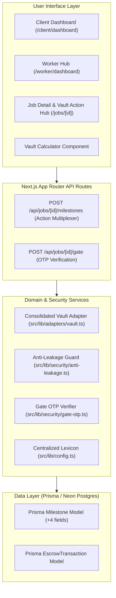
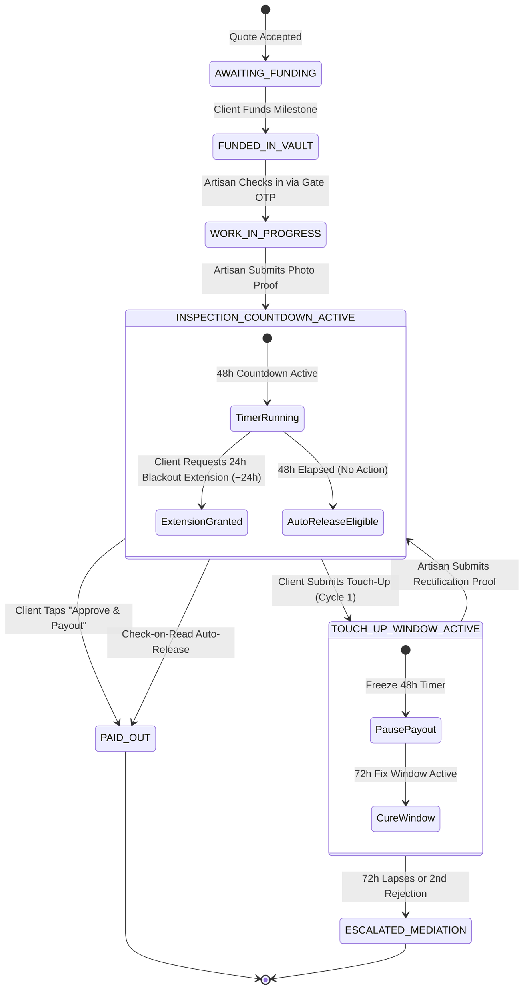

# Milestone Vault & Job Guarantee Architecture

*   **Author:** shayl
*   **Status:** Approved
*   **Date:** 2026-11-03

--------------------------------------------------------------------------------

## Overview

BuildSafe SA connects South African homeowners with vetted skilled artisans (plumbers, electricians, builders, carpenters). The current platform uses legalistic "escrow" phrasing across its user interface, causing confusion and apprehension among both homeowners and artisans in South Africa. Furthermore, holding models that allow unilateral client refund claims expose artisans to contractor wage theft, while models charging fees on hardware materials incentivize off-platform cash transactions.

This design document establishes the **Milestone Vault & Job Guarantee** system. It replaces alienating legal jargon with accessible terminology, separates 0%-fee hardware store pass-through receipts from labour milestones, establishes an automated 48-hour inspection countdown to prevent client ghosting, and introduces a customer-facing **72-Hour Fix Window** ("Request a Touch-Up") that gives artisans a direct opportunity to inspect and fix flagged issues before any payment freeze can occur (fulfilling the legal protections of CPA Section 54 without burdening users with legal jargon).

Following multi-lens EGM Goldfish review, this specification applies the **Minimal Essential Architecture**: it avoids phantom database tables by evolving existing Prisma models, consolidates duplicate financial adapters, and modifies the existing API route handler while preserving critical variation order workflows.

## The Problem

1. **Jargon Alienation ("Escrow")**:
   * The term "escrow" appears across UI headers, buttons (`Release Milestone Escrow`), fee calculators, and status badges (`ESCROW_FUNDED`).
   * In South Africa, "escrow" is perceived as conveyancing and corporate legal jargon. For artisans, it raises fears that their money is trapped in a corporate bank that will side with the homeowner. For homeowners, it sounds like an administrative barrier rather than a safety guarantee.

2. **Asymmetric Counterparty Risk & Wage Theft**:
   * Labor cannot be repossessed once performed. If a platform gives homeowners unilateral power to cancel a milestone or demand a full refund after completion, artisans carry all counterparty risk.
   * Under South African common law (*BK Tooling v Scope Precision Engineering* 1979) and statutory law (CPA Section 54), a client cannot withhold 100% of payment for minor defects if substantial performance was rendered, and must allow the contractor a reasonable opportunity to remedy defects.

3. **Material Fee Disintermediation**:
   * Charging platform commission on pass-through materials (e.g. tile boxes, copper piping, cement bags) penalizes artisans who operate on narrow margins. This actively forces both parties to settle materials off-platform in cash, leading to complete transaction leakage.

4. **Homeowner Ghosting After Completion**:
   * When an artisan finishes a job, homeowners often delay formal sign-off due to busy schedules, forgetting, or bad faith. Without an automated release mechanism, artisan funds remain locked indefinitely.

## Goals

* **G1: Terminology Normalization**: Remove all user-facing instances of "escrow" across navigation, dashboards, calculators, job views, and status badges, replacing them with "Milestone Vault" and "Job Guarantee".
* **G2: Strict Segregation of Materials and Labour**: Enforce a 0% platform fee on itemized hardware store receipts (Builders Warehouse, Cashbuild), keeping material reimbursement at exact pass-through cost.
* **G3: Automated 48-Hour Inspection Timer**: Trigger an automated 48-hour countdown clock when an artisan submits timestamped photo proof of completion. If the client takes no action, funds auto-release to the artisan.
* **G4: 72-Hour Fix Window ('Request a Touch-Up')**: Replace adversarial dispute/refund buttons with a simple "Request a Touch-Up" action. Clients flagging issues upload a photo and note, giving the artisan a clear 72-hour window to return and fix the problem before any payment is frozen or escalated.
* **G5: Abstract Sandbox Vault Adapter**: Consolidate calculations and lifecycle handling into a single `src/lib/adapters/vault.ts` module with backward-compatible aliases, enabling isolated testing without live banking dependencies.

## Non-Goals

* Holding client deposit funds directly in BuildSafe SA's operational company checking accounts (custodial holding in production must route through a licensed third-party trust/escrow partner).
* Operating an internal consumer credit or material financing facility.
* Creating redundant relational join tables (`milestone_proofs`, `cpa_cure_events`) where existing Prisma models suffice.
* Integrating external WhatsApp Business or SMS gateways during the local sandbox testing phase (in-app alerts and status chips fully satisfy verification).
* Automating formal legal arbitration for claims exceeding the held milestone value (unresolved claims escalate to human mediation).

## Open Questions & Resolutions

* **Question 1: Load Shedding / Network Blackout Handling**: How should the system handle national load shedding or major cellular network blackouts that prevent a homeowner from accessing the app during the 48-hour inspection countdown?
  * **Resolution**: The inspection card on the client dashboard includes a 1-tap **"Request 24h Extension"** button. If blackouts or travel prevent immediate physical inspection, the client can grant themselves a single 24-hour extension (`extensionGranted = true`), extending the inspection window to 72 hours total.
* **Question 2: Multi-Stage Milestone Sequencing**: In multi-stage projects with multiple milestones, can an artisan proceed to Milestone 2 before Milestone 1 is released, or must each milestone be funded and settled sequentially?
  * **Resolution**: Sequential milestone progression is enforced by default. Milestone 2 can only transition to `WORK_IN_PROGRESS` after Milestone 1 is funded and either completed or explicitly unlocked by client variance.

## Critical User Journeys (CUJs)

### CUJ 1: Homeowner Funds Milestone Vault & Unlocks Gate Check-In

*   **Given**: A homeowner accepts a plumber's quote (R3,000 labour + R800 estimated materials).
*   **When**: The homeowner clicks "Secure Funds in Milestone Vault" and completes payment of the R250 commitment deposit and R3,000 labour milestone.
*   **Then**: The vault status updates to "Funds Secured in Vault", the masked contact details unlock, and a 6-digit Gate OTP is generated for the artisan's physical arrival.

### CUJ 2: Artisan Submits Photo Proof & 48-Hour Timer Auto-Releases

*   **Given**: An artisan completes bathroom tiling and checks out via Gate OTP.
*   **When**: The artisan uploads two photos (wide shot of finished floor and close-up of grouting) and taps "Submit Work for Payout".
*   **Then**: The milestone transitions to `INSPECTION_COUNTDOWN_ACTIVE`. The homeowner sees the active 48-hour inspection countdown on their dashboard. If the homeowner does not respond or request a touch-up, funds release automatically to the artisan at $T+48$ hours.

### CUJ 3: Homeowner Requests a Touch-Up & Artisan Rectifies

*   **Given**: A milestone is in the 48-hour inspection window, and the homeowner identifies an unsealed pipe joint.
*   **When**: The homeowner clicks "Request a Touch-Up", attaches a photo of the leaking joint, and submits a brief description.
*   **Then**: The 48-hour auto-release timer pauses immediately. The milestone enters `TOUCH_UP_WINDOW_ACTIVE`, and the artisan receives an in-app alert with a 72-hour countdown to inspect and fix the issue. When the artisan submits rectification proof, the milestone returns to `INSPECTION_COUNTDOWN_ACTIVE`. (A maximum of 1 touch-up cycle is allowed per milestone before escalating to mediation).

--------------------------------------------------------------------------------

## Technical Plan (Architecture)

### 1. Minimal Architectural Topology

The architecture unifiesfunds orchestration, state management, and user interfaces into a streamlined topology:



### 2. Milestone Finite State Machine (FSM)

Each job milestone operates as an isolated state machine with strict state transitions, enforcing legal and temporal invariants:



### 3. Unified API Specifications (`src/app/api/jobs/[id]/milestones/route.ts`)

Instead of creating 5 distinct route directories, all milestone operations are handled by the existing `POST /api/jobs/[id]/milestones` endpoint via an `action` discriminator:

#### A. `action === "FUND_MILESTONE"`
* **Caller**: Authenticated Homeowner.
* **Payload**: `{ "action": "FUND_MILESTONE", "milestoneId": "string", "paymentMethod": "SANDBOX_EFT" | "CARD" }`.
* **Behavior**:
  * Calls `vaultAdapter.allocateFunds({ milestoneId, amount })`.
  * Transitions milestone to `FUNDED_IN_VAULT`.
  * Generates Gate OTP for artisan check-in if not already active.
* **Response**: `HTTP 200 { "status": "FUNDED_IN_VAULT", "gateOtp": "482915" }`.

#### B. `action === "SUBMIT_PROOF"` (and Rectification Proof)
* **Caller**: Authenticated Artisan.
* **Payload**: `{ "action": "SUBMIT_PROOF", "milestoneId": "string", "photoUrls": string[], "notes": "string" }`.
* **Preconditions**: Milestone status must be `WORK_IN_PROGRESS` or `TOUCH_UP_WINDOW_ACTIVE`; `photoUrls.length >= 1`.
* **Behavior**:
  * Stores `proofPhotosJson = JSON.stringify(photoUrls)` and `proofNotes = notes`.
  * Sets `proofSubmittedAt = new Date()`.
  * Sets `autoReleaseDeadline = new Date(Date.now() + 48 * 3600 * 1000)`.
  * Transitions milestone status to `INSPECTION_COUNTDOWN_ACTIVE`.
* **Response**: `HTTP 200 { "status": "INSPECTION_COUNTDOWN_ACTIVE", "autoReleaseDeadline": "ISO_TIMESTAMP" }`.

#### C. `action === "APPROVE_PAYOUT"`
* **Caller**: Authenticated Homeowner.
* **Payload**: `{ "action": "APPROVE_PAYOUT", "milestoneId": "string" }`.
* **Behavior**:
  * Executes inside an atomic Prisma transaction: `prisma.$transaction(async (tx) => { ... })`.
  * Verifies milestone is in `INSPECTION_COUNTDOWN_ACTIVE` or `WORK_IN_PROGRESS`.
  * Dispatches payout through `vaultAdapter.disbursePayout(milestoneId, "payout_milestone_" + milestoneId)`.
  * Updates status to `PAID_OUT`.
* **Response**: 
  ```json
  {
    "status": "PAID_OUT",
    "labourGrossZar": 3000.00,
    "platformFeeZar": 240.00,
    "artisanNetZar": 2760.00,
    "reimbursedMaterialsZar": 0.00
  }
  ```

#### D. `action === "REQUEST_TOUCH_UP"`
* **Caller**: Authenticated Homeowner.
* **Payload**: `{ "action": "REQUEST_TOUCH_UP", "milestoneId": "string", "defectDescription": "string", "evidencePhotos": string[] }`.
* **Preconditions**: Must be in `INSPECTION_COUNTDOWN_ACTIVE`; `defectDescription.length >= 20`; `touchUpCount < 1`.
* **Behavior**:
  * Clears `autoReleaseDeadline = null`.
  * Sets `cureDeadline = new Date(Date.now() + 72 * 3600 * 1000)`.
  * Increments `touchUpCount = touchUpCount + 1`.
  * Sets status to `TOUCH_UP_WINDOW_ACTIVE`.
* **Response**: `HTTP 200 { "status": "TOUCH_UP_WINDOW_ACTIVE", "cureDeadline": "ISO_TIMESTAMP" }`.

#### E. `action === "REQUEST_EXTENSION"` (Load Shedding / Blackout Resilience)
* **Caller**: Authenticated Homeowner.
* **Payload**: `{ "action": "REQUEST_EXTENSION", "milestoneId": "string" }`.
* **Preconditions**: Must be in `INSPECTION_COUNTDOWN_ACTIVE`; `extensionGranted === false`.
* **Behavior**:
  * Adds 24 hours to existing `autoReleaseDeadline`.
  * Sets `extensionGranted = true`.
* **Response**: `HTTP 200 { "status": "INSPECTION_COUNTDOWN_ACTIVE", "autoReleaseDeadline": "ISO_TIMESTAMP", "extensionGranted": true }`.

#### F. Auto-Release (Check-on-Read Invariant)
* Instead of deploying an external cron daemon, auto-release is evaluated lazily whenever milestone details or job lists are fetched:
  * If `status === "INSPECTION_COUNTDOWN_ACTIVE"` AND `new Date() >= autoReleaseDeadline`:
  * Atomically transition status to `PAID_OUT` and disburse payout using the canonical idempotency key `payout_milestone_${milestoneId}`.

### 4. Data Layer: Lean Prisma Schema Evolution

Instead of creating 4 redundant join tables, the existing `model Milestone` in `prisma/schema.prisma` is evolved with 6 lightweight fields:

```prisma
model Milestone {
  id                  String    @id @default(cuid())
  jobId               String
  sequence            Int
  kind                String    // CALL_OUT_DEPOSIT | MAIN_WORK | VARIATION_ORDER
  title               String
  description         String
  labourAmountZar     Float
  materialsAmountZar  Float     @default(0)
  materialReceiptRef  String?
  status              String    @default("AWAITING_FUNDING")

  // --- Lean Milestone Vault Fields ---
  proofPhotosJson     String    @default("[]")
  proofNotes          String?
  proofSubmittedAt    DateTime?
  autoReleaseDeadline DateTime?
  cureDeadline        DateTime?
  defectDescription   String?
  extensionGranted    Boolean   @default(false)
  touchUpCount        Int       @default(0)

  createdAt           DateTime  @default(now())
  updatedAt           DateTime  @updatedAt

  job                 Job       @relation(fields: [jobId], references: [id], onDelete: Cascade)
  escrowTransaction   EscrowTransaction?

  @@index([status, autoReleaseDeadline])
}
```

### 5. Consolidated Domain Adapter (`src/lib/adapters/vault.ts`)

`src/lib/adapters/vault.ts` unifies calculations and sandbox state management into a single module (<100 LOC):

```typescript
import { DEFAULT_PLATFORM_CONFIG, FeeConfig } from "@/lib/config";

export interface MilestoneCalculationInput {
  labourZar: number;
  materialsZar?: number;
  isRepeatBooking?: boolean;
  config?: Partial<FeeConfig>;
}

export interface MilestoneSplitBreakdown {
  labourZar: number;
  materialsZar: number;
  buyerTrustFeePct: number;
  buyerTrustFeeZar: number;
  grossBuyerPaidZar: number;
  workerCommissionPct: number;
  workerCommissionZar: number;
  workerNetPayoutZar: number;
  platformTotalCutZar: number;
}

export function computeMilestoneSplit(input: MilestoneCalculationInput): MilestoneSplitBreakdown {
  const labourZar = Math.max(0, Math.round(input.labourZar * 100) / 100);
  const materialsZar = Math.max(0, Math.round((input.materialsZar ?? 0) * 100) / 100);
  const config = { ...DEFAULT_PLATFORM_CONFIG, ...input.config };

  const buyerTrustFeePct = config.buyerTrustFeePct;
  const workerCommissionPct = input.isRepeatBooking
    ? config.repeatClientCommissionPct
    : config.workerLabourCommissionPct;

  const buyerTrustFeeZar = Math.round(labourZar * buyerTrustFeePct * 100) / 100;
  const grossBuyerPaidZar = Math.round((labourZar + materialsZar + buyerTrustFeeZar) * 100) / 100;
  const workerCommissionZar = Math.round(labourZar * workerCommissionPct * 100) / 100;
  const workerNetPayoutZar = Math.round((labourZar - workerCommissionZar + materialsZar) * 100) / 100;
  const platformTotalCutZar = Math.round((buyerTrustFeeZar + workerCommissionZar) * 100) / 100;

  return {
    labourZar,
    materialsZar,
    buyerTrustFeePct,
    buyerTrustFeeZar,
    grossBuyerPaidZar,
    workerCommissionPct,
    workerCommissionZar,
    workerNetPayoutZar,
    platformTotalCutZar,
  };
}

// Backward-compatible alias
export const computeEscrowSplit = computeMilestoneSplit;

export interface AbstractVaultAdapter {
  allocateFunds(input: { milestoneId: string; labourZar: number; materialsZar?: number }): Promise<{ success: boolean; vaultRef: string }>;
  pauseForTouchUp(milestoneId: string): Promise<{ paused: boolean }>;
  disbursePayout(milestoneId: string, idempotencyKey: string): Promise<{ success: boolean; disbursedAt: string }>;
  getVaultStatus(milestoneId: string): Promise<{ status: string; balanceZar: number }>;
}

export const vaultAdapter: AbstractVaultAdapter = {
  async allocateFunds({ milestoneId, labourZar, materialsZar = 0 }) {
    return { success: true, vaultRef: `VAULT-${milestoneId.slice(0, 8).toUpperCase()}` };
  },
  async pauseForTouchUp(milestoneId: string) {
    return { paused: true };
  },
  async disbursePayout(milestoneId: string, idempotencyKey: string) {
    return { success: true, disbursedAt: new Date().toISOString() };
  },
  async getVaultStatus(milestoneId: string) {
    return { status: "SECURED", balanceZar: 3000 };
  },
};

export const escrowAdapter = vaultAdapter;
```

### 6. Centralized UI Lexicon (`src/lib/config.ts`)

To avoid ad-hoc string churn, all user-facing copy is consolidated into `VAULT_LEXICON` in `src/lib/config.ts`:

```typescript
export const VAULT_LEXICON = {
  vaultName: "Milestone Vault",
  jobGuarantee: "Job Guarantee",
  fundedBadge: "FUNDS SECURED IN VAULT",
  approveButton: "Approve & Payout Labour",
  touchUpButton: "Request a Touch-Up",
  touchUpBanner: "72-Hour Fix Window Active",
  preBookingProtection: "Pre-Booking Protection",
  extensionButton: "Request 24h Blackout Extension",
} as const;
```

#### Lexicon Migration Map

| Legacy Term | Centralized Plain-English Term | Component Call Site |
| :--- | :--- | :--- |
| `"Milestone Escrow"` | `VAULT_LEXICON.vaultName` | `src/app/page.tsx`, `Navbar.tsx` |
| `"ESCROW_FUNDED"` | `VAULT_LEXICON.fundedBadge` | `client/dashboard/page.tsx`, `jobs/page.tsx` |
| `"Release Milestone Escrow"` | `VAULT_LEXICON.approveButton` | `src/app/page.tsx`, `jobs/[id]/page.tsx` |
| `"Pre-Escrow Anti-Leakage"` | `VAULT_LEXICON.preBookingProtection` | `src/lib/security/anti-leakage.ts` |
| `"Dispute / Legal Claim"` | `VAULT_LEXICON.touchUpButton` | `src/app/jobs/[id]/page.tsx` |
| `"CPA Section 54 Cure"` | `VAULT_LEXICON.touchUpBanner` | `src/app/jobs/[id]/page.tsx` |

--------------------------------------------------------------------------------

## Alternatives Considered

### Alternative A: Pure Lead-Generation & Directory Model (inDrive-Style / Off-Platform Cash)

*   **Pros**:
    *   Zero financial compliance overhead (no SARB, FICA, or trust account regulations).
    *   Simpler codebase: deletes payment webhooks and dispute state machines.
*   **Cons**:
    *   **Near-100% Disintermediation**: Once contact details or job addresses are shared, parties immediately take the transaction offline to bypass fees.
    *   **Artisan Churn from Lead Fees**: Skilled contractors reject upfront pay-per-lead models (e.g. Bark, Kandua) where they pay for quotes that rarely convert.
    *   **Zero Brand Defense**: Offers no protection against disappearing contractors or non-paying homeowners.
*   **Reason for Rejection**: Rejected by author: Guarantees near-total off-platform disintermediation, alienates artisans with upfront quoting fees, and destroys BuildSafe's primary value proposition of trust and fraud protection.

### Alternative B: 100% Full Upfront Project Budget Lock

*   **Pros**:
    *   Complete financial commitment from the client before any tradesperson arrives on site.
*   **Cons**:
    *   Severe consumer friction: Freezing tens of thousands of Rands upfront creates unacceptable drop-off in quote acceptance.
    *   Starves contractors of staged liquidity needed for ongoing transport, consumables, and day-to-day operations.
*   **Reason for Rejection**: Rejected by author: Creates severe conversion friction for homeowners and denies contractors necessary phased cash flow during multi-week trade jobs.

### Alternative C: Unilateral Client Refund Button (E-Commerce Return Model)

*   **Pros**:
    *   Provides maximum peace of mind to homeowners unfamiliar with hiring trades online.
*   **Cons**:
    *   Physical construction labor cannot be repossessed or returned once rendered.
    *   Enables client wage theft and weaponized holdouts against honest artisans.
    *   Directly violates South African contract law (*BK Tooling*) and Consumer Protection Act Section 54, which guarantees contractors the statutory right to remedy defects before price reductions or refunds can be enforced.
*   **Reason for Rejection**: Rejected by author: Unfairly forces artisans to carry 100% of counterparty risk, violates South African consumer law, and destroys artisan retention.

### Alternative D: Operating an Unlicensed Internal Ledger / Float Account

*   **Pros**:
    *   Allows BuildSafe to capture interest on fund float and avoid third-party payment gateway transaction splits.
*   **Cons**:
    *   Directly violates the South African Banks Act and Reserve Bank regulations against unlicensed deposit-taking.
*   **Reason for Rejection**: Rejected by author: Extreme regulatory and legal liability. BuildSafe must operate purely as a software orchestrator, relying on sandbox adapters during testing and licensed trust partners in production.

--------------------------------------------------------------------------------

## Detailed Implementation Plan

### Target Files to Create/Modify

#### 1. `c:/Users/shayl/ai-for-africa/prisma/schema.prisma` (Modify)

*   **Type / Scope**: Data Model & Database Schema
*   **Proposed Changes**:
    *   Add 6 lightweight fields to `model Milestone`:
        *   `proofPhotosJson String @default("[]")`
        *   `proofNotes String?`
        *   `proofSubmittedAt DateTime?`
        *   `autoReleaseDeadline DateTime?`
        *   `cureDeadline DateTime?`
        *   `defectDescription String?`
        *   `extensionGranted Boolean @default(false)`
        *   `touchUpCount Int @default(0)`
    *   Add composite index: `@@index([status, autoReleaseDeadline])`.
*   **Rationale**: Persists photo proof, timer deadlines, and touch-up cycle counts without creating redundant relational join tables.

#### 2. `c:/Users/shayl/ai-for-africa/src/lib/config.ts` (Modify)

*   **Type / Scope**: Configuration & Central Lexicon Dictionary
*   **Proposed Changes**:
    *   Export `VAULT_LEXICON` containing standardized strings for `vaultName`, `jobGuarantee`, `fundedBadge`, `approveButton`, `touchUpButton`, `touchUpBanner`, and `preBookingProtection`.
*   **Rationale**: Centralizes all user-facing terminology in a single source of truth, eliminating ad-hoc string churn across pages.

#### 3. `c:/Users/shayl/ai-for-africa/src/lib/adapters/vault.ts` (Create)

*   **Type / Scope**: Consolidated Financial & Sandbox Vault Adapter
*   **Proposed Changes**:
    *   Implement `computeMilestoneSplit` with 0% fee on hardware materials and separate labour platform cuts.
    *   Implement `vaultAdapter` singleton implementing `allocateFunds`, `pauseForTouchUp`, `disbursePayout`, and `getVaultStatus`.
    *   Export backward-compatible aliases: `computeEscrowSplit = computeMilestoneSplit` and `escrowAdapter = vaultAdapter`.
*   **Rationale**: Consolidates financial calculations and sandbox state into a single cohesive module, avoiding duplicate adapter maintenance.

#### 4. `c:/Users/shayl/ai-for-africa/src/lib/adapters/escrow.ts` (Modify)

*   **Type / Scope**: Re-Export Passthrough Shim
*   **Proposed Changes**:
    *   Replace entire file contents with a single re-export line: `export * from "./vault";`.
*   **Rationale**: Ensures 100% backward compatibility for existing imports while maintaining a single implementation.

#### 5. `c:/Users/shayl/ai-for-africa/src/lib/security/anti-leakage.ts` (Modify)

*   **Type / Scope**: Security & Masked Chat Sanitizer
*   **Proposed Changes**:
    *   Update `sanitizeChatMessage` signature to accept a polymorphic second parameter:
        ```typescript
        export function sanitizeChatMessage(
          rawText: string,
          isFundedOrOptions: boolean | { isVaultFunded?: boolean; isEscrowFunded?: boolean }
        ): SanitizedChatResult
        ```
    *   Update warning log text from `"Pre-Escrow Phone Redaction"` to `VAULT_LEXICON.preBookingProtection`.
*   **Rationale**: Supports both boolean and options objects without breaking existing callers across chat components.

#### 6. `c:/Users/shayl/ai-for-africa/src/app/api/jobs/[id]/milestones/route.ts` (Modify)

*   **Type / Scope**: Next.js App Router API Handler
*   **Proposed Changes**:
    *   Preserve existing `action === "CREATE_VARIATION"` order creation untouched.
    *   Update `action === "SUBMIT_PROOF"`: support both `WORK_IN_PROGRESS` and `TOUCH_UP_WINDOW_ACTIVE`, save `proofPhotosJson`, and set `autoReleaseDeadline`.
    *   Update `action === "APPROVE_PAYOUT"`: wrap in `prisma.$transaction`, disburse via `vaultAdapter.disbursePayout` with key `payout_milestone_${milestoneId}`, and return itemized breakdown.
    *   Add `action === "REQUEST_TOUCH_UP"`: guard `touchUpCount < 1`, set `cureDeadline = NOW() + 72h`, set status to `TOUCH_UP_WINDOW_ACTIVE`.
    *   Add `action === "REQUEST_EXTENSION"`: add 24 hours to `autoReleaseDeadline` if `extensionGranted === false`.
*   **Rationale**: Modifies the existing 246-line route handler in-place, preserving variation orders while implementing the new state transitions.

#### 7. `c:/Users/shayl/ai-for-africa/src/components/EscrowCalculator.tsx` (Modify)

*   **Type / Scope**: Client React Component
*   **Proposed Changes**:
    *   Update Line 110: Replace `"Escrow Breakdown"` with `"Milestone Vault Breakdown"`.
    *   Update Line 149: Replace `"1. Buyer Escrow Total"` with `"1. Buyer Vault Total"`.
    *   Import and use `VAULT_LEXICON`.
*   **Rationale**: Replaces legacy escrow labels with verified strings matching the actual component markup.

#### 8. `c:/Users/shayl/ai-for-africa/src/app/page.tsx` (Modify)

*   **Type / Scope**: Public Landing Page
*   **Proposed Changes**:
    *   Update Line 48: Replace `"// 00 · VETTED SOUTH AFRICAN ARTISANS & ESCROW"` with `"// 00 · VETTED SOUTH AFRICAN ARTISANS & MILESTONE VAULT"`.
    *   Update Line 132: Replace `"manage milestone escrow payments"` with `"manage milestone vault payments"`.
    *   Update Line 190: Replace `"Escrow protections apply solely to labour"` with `"Vault protections apply solely to labour"`.
    *   Update Line 268: Replace `"// 02 · ESCROW FEE & DISPUTE PROTECTIONS"` with `"// 02 · MILESTONE VAULT & JOB GUARANTEE"`.
*   **Rationale**: Eliminates all user-facing instances of "escrow" on the landing page using verified line numbers.

#### 9. `c:/Users/shayl/ai-for-africa/src/app/client/dashboard/page.tsx` (Modify)

*   **Type / Scope**: Homeowner Dashboard Page
*   **Proposed Changes**:
    *   Add status mapping dictionary: `const STATUS_LABELS = { ESCROW_FUNDED: VAULT_LEXICON.fundedBadge };`.
    *   Update Line 362 display text to render `STATUS_LABELS[job.status] || job.status`.
*   **Rationale**: Ensures clients see "FUNDS SECURED IN VAULT" on their job cards without altering raw database enums.

#### 10. `c:/Users/shayl/ai-for-africa/src/app/worker/dashboard/page.tsx` (Modify)

*   **Type / Scope**: Artisan Worker Hub Dashboard
*   **Proposed Changes**:
    *   Update Line 448: Replace `"Completed Escrow Jobs:"` with `"Completed Protected Jobs:"`.
*   **Rationale**: Replaces legacy text on the artisan wallet card.

#### 11. `c:/Users/shayl/ai-for-africa/src/app/jobs/[id]/page.tsx` (Modify)

*   **Type / Scope**: Job Action & Milestone Hub Page
*   **Proposed Changes**:
    *   Update tab button label to `"// VAULT & PAYMENTS"`.
    *   Add 48-Hour Inspection Countdown timer card with "Request 24h Blackout Extension" button.
    *   Add "Request a Touch-Up" modal calling `action: "REQUEST_TOUCH_UP"`.
    *   Add 72-Hour Fix Window banner when status is `TOUCH_UP_WINDOW_ACTIVE`.
*   **Rationale**: Integrates the complete inspection and touch-up lifecycle directly into the primary job workspace.

#### 12. `c:/Users/shayl/ai-for-africa/tests/milestone-vault.test.ts` (Create)

*   **Type / Scope**: Vitest Integration Test Suite
*   **Proposed Changes**:
    *   Test 1: Verify `computeMilestoneSplit` calculates 0% fee on materials and correct labour platform cuts.
    *   Test 2: Verify `SUBMIT_PROOF` transitions to `INSPECTION_COUNTDOWN_ACTIVE` and sets `autoReleaseDeadline`.
    *   Test 3: Verify `REQUEST_TOUCH_UP` pauses countdown and sets `cureDeadline` to 72 hours.
    *   Test 4: Verify `REQUEST_EXTENSION` grants a single 24-hour extension.
    *   Test 5: Verify `anti-leakage` accepts both boolean and options objects.
*   **Rationale**: Provides automated verification of all legal and architectural invariants.

---

### Verification Plan

*   **Database Schema Generation**:
    *   Execute `npx prisma db push && npx prisma generate` to apply schema updates and regenerate the Prisma client.
*   **Type Safety & Compilation**:
    *   Execute `npm run build` to verify clean bundle compilation with zero TypeScript errors.
*   **Automated Unit & Integration Tests**:
    *   Execute `npm test -- tests/milestone-vault.test.ts src/lib/__tests__/anti-leakage.test.ts`.
    *   Ensure 100% pass rate across milestone calculations, FSM transitions, and anti-leakage phone masking.
*   **Jargon Scan**:
    *   Execute in PowerShell:
        ```powershell
        Get-ChildItem -Path src/app, src/components -Recurse -Include *.tsx,*.ts | Select-String -Pattern '\b(escrow|statutory right to cure|BK Tooling)\b' -CaseSensitive:$false
        ```
    *   Verify zero user-facing string occurrences.
*   **Browser & UI Verification**:
    *   Verify landing page displays `"// 02 · MILESTONE VAULT & JOB GUARANTEE"`.
    *   Verify client dashboard displays `"FUNDS SECURED IN VAULT"`.
    *   Verify job workspace renders 48h countdown and touch-up action buttons.

--------------------------------------------------------------------------------

*Drafted with EGM*
